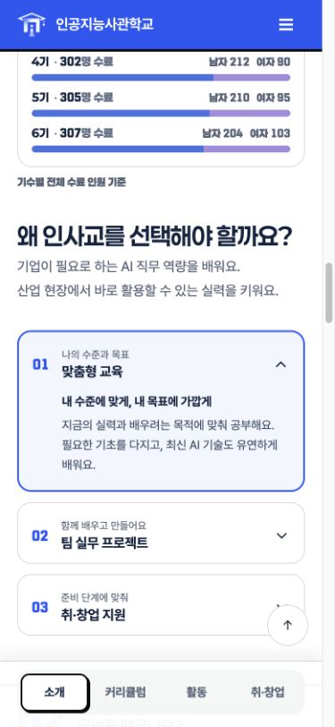
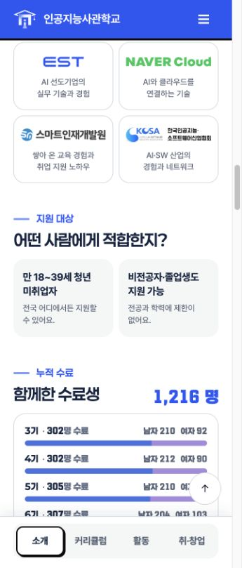
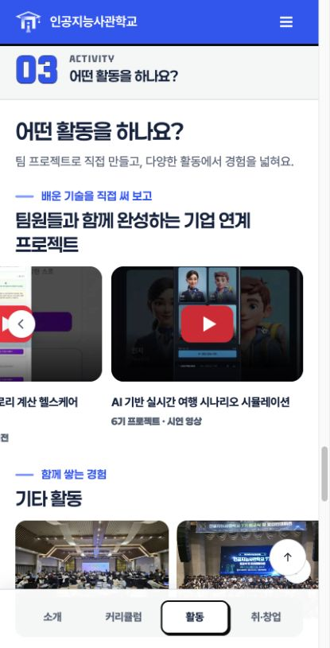
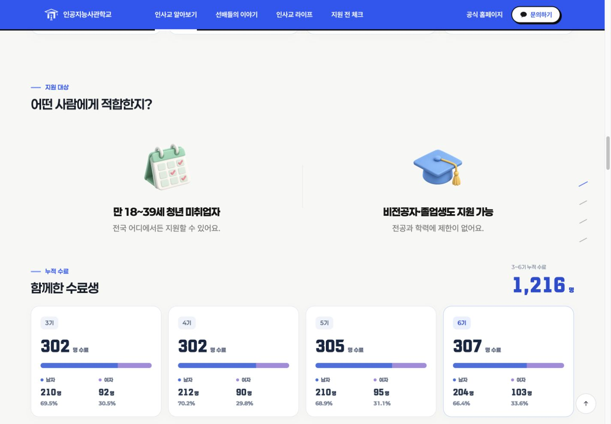

# 알아보기 모바일 간격 보정

기존 모바일 작업의 후속 요청 네 가지를 `about/css/about-m.css`, `about/js/about-m.js`에 반영했다. 원본 템플릿의 캐시 버전과 생성 HTML도 갱신했다. 라이프 변경을 보존해 기존 작업 브랜치/PR에 추가한다.

- 왜 인사교 아코디언: 숨겨진 마지막 그림의 margin 대신 열린 카드에 아래 padding을 적용. 실제 첫 줄/마지막 문단 기준 위아래 20px.
- 프로젝트·활동 사진 화살표: 제목과 설명을 포함한 영역 대신 사진/영상 중심으로 위치 계산. ResizeObserver로 화면 크기 변경도 반영. 뉴스 카드는 기존 기준 유지.
- 교육 시간: 숫자의 `min-width:5ch`를 모바일에서 해제하여 `1,216명`과 동일한 8px 단위 간격으로 표시.
- 지원 대상: 두 카드의 그리드 정렬을 stretch로 지정해 같은 높이 유지.

## 검증

- `npm run build`, `npm test` (17개 통과), `npm run check`, `git diff --check`.
- 360/390/430px: 위아래 여백 20/20px, 숫자 단위 gap 8px, 화살표/사진 중심 차이 0px, 가로 넘침 없음.
- 지원 대상 두 카드 높이: 360/390px에서 116/116px, 430px에서 98/98px.
- 아코디언 닫기/펼치기와 프로젝트 다음 화살표의 가로 스크롤 확인. 콘솔 오류 없음.
- 1440px: 지원 대상·아코디언·교육 시간·프로젝트·활동 갤러리의 크기/패딩/서체가 원본과 일치.
- 공통 헤더/푸터, 콘텐츠, Spring 연동/이야기 선택자/API는 변경하지 않음. Spring 실환경은 검증하지 않음.

