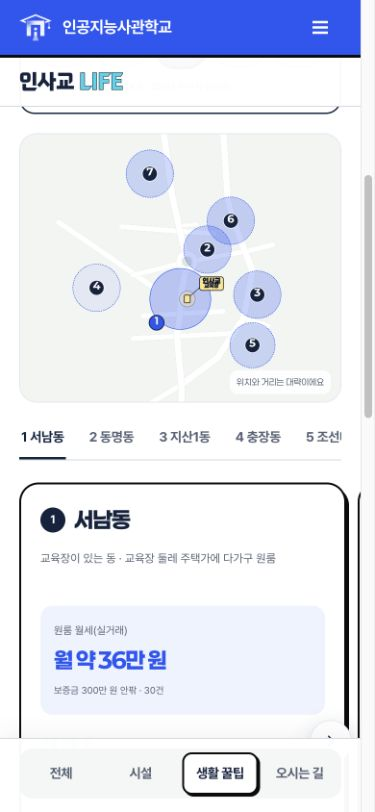
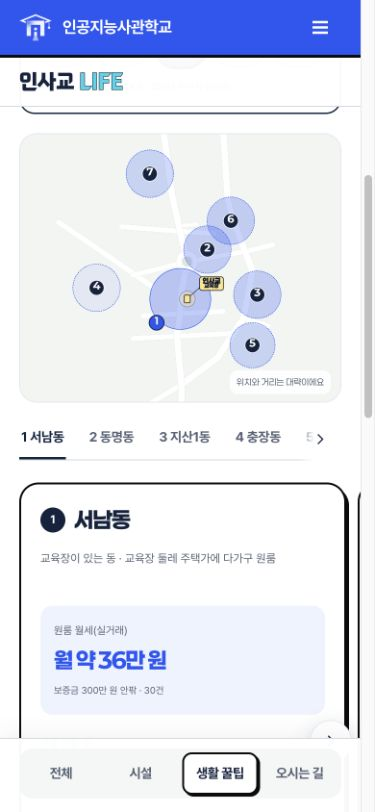
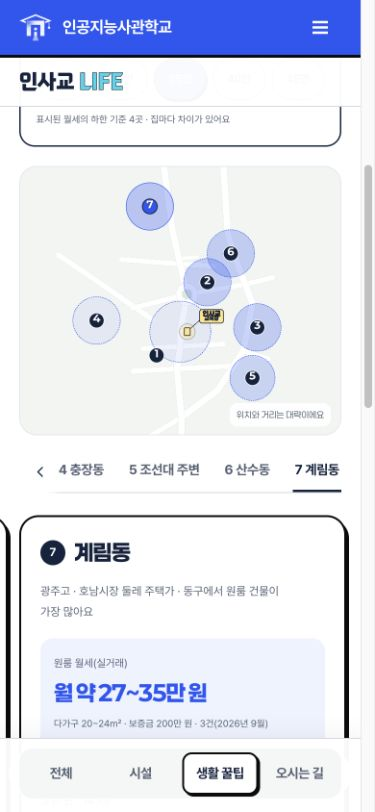
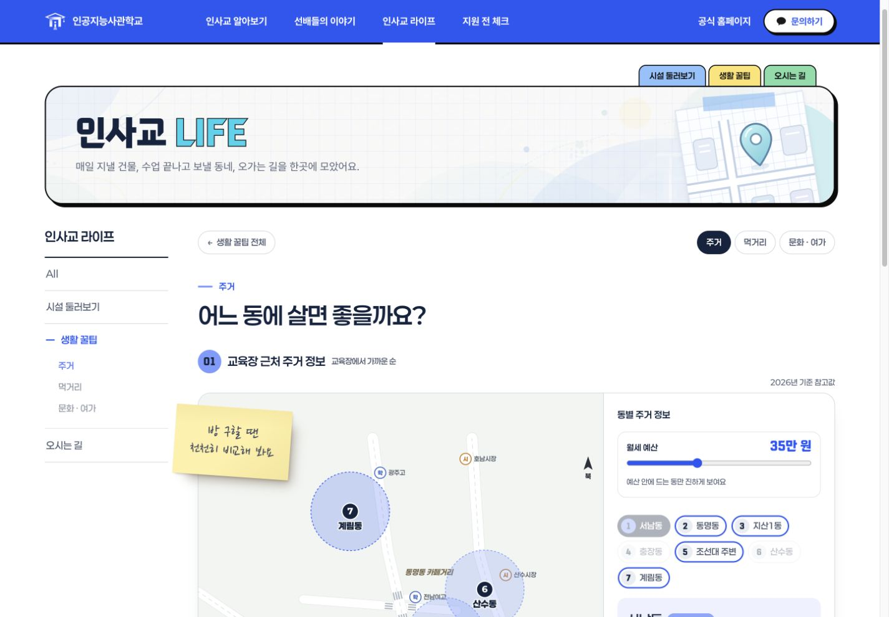
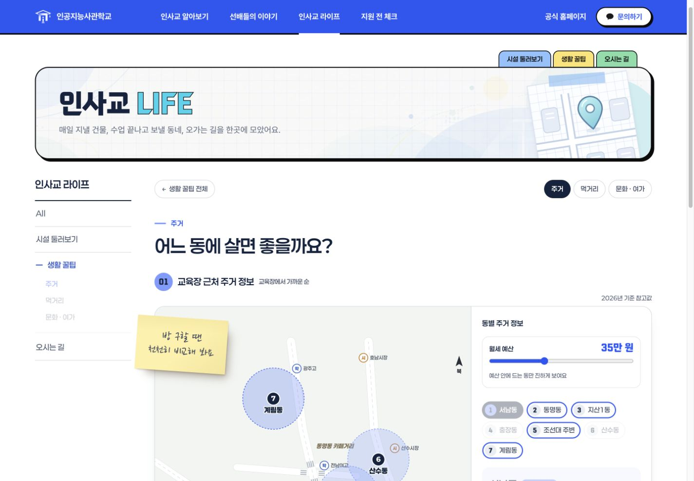

# 모바일 주거 동 선택 탭 이동 표시

PR #29가 병합된 최신 `main` (`e5b5836`)에서 `codex/life-area-tab-arrows` 브랜치로 작업했다. 별도 검수 복사본이 아닌 원본 LIFE 소스의 모바일 주거 화면을 수정했다. 공개 사이트 반영은 이 PR의 병합 이후다.

## 변경

- 기존 밑줄 탭을 유지하고, 숨겨진 동이 있는 쪽에만 16px 화살표와 흰색 페이드를 표시한다. 각 화살표의 클릭 영역은 44px이다.
- 화살표는 목록만 이동한다. 선택한 동·지도·카드는 바꾸지 않는다. 처음에는 오른쪽, 마지막에는 왼쪽 화살표만 표시한다.
- 동 선택, 지도 선택, 아래 카드 이동에 맞춰 선택된 동이 화살표에 가리지 않도록 탭 위치를 맞춘다. 카드 이동 중에는 탭을 반복 이동하지 않고 스크롤이 끝난 뒤 맞춘다.
- 기존 가로 스크롤 구조를 유지한다. 키보드로 탭에 진입해도 해당 동이 보이며, 끝에 도달해 화살표가 사라질 때는 반대편 화살표로 포커스를 넘긴다.
- 모션 감소 설정에서는 화살표 이동 애니메이션을 사용하지 않는다. 화면 재렌더링 때 관찰자와 예약된 탭 위치 갱신을 정리한다.
- 모바일 LIFE 주거 화면에만 적용한다. 콘텐츠·데스크톱 스타일·시설 사진 순환·홈 전광판·메뉴 동작은 수정하지 않는다.

## 검증

- `npm run build`, `npm test` **74개**, `npm run check`, 두 LIFE 스크립트의 `node --check`, `git diff --check` 통과.
- 기존 정적 미리보기 서버 `http://127.0.0.1:4175` 재사용. 4173의 검수 복사본 서버는 그대로 유지했다.
- 인앱 브라우저 360·390·430px: 가로 넘침 없음, 마지막 계림동 탭 노출, 화살표 방향/끝 상태, 동 선택과 지도/카드 연동 확인.
- 키보드 Enter로 양끝 이동, 선택 상태 유지, 사라지는 화살표의 포커스 복귀, 지도 키보드 선택 확인.
- `#hzp-6` 직접 진입 시 계림동 선택 및 탭 오른쪽 끝 노출 확인.
- 1440px: 원본과 수정본 캡처 비교, 원본 데스크톱 구성 유지 및 모바일 화살표 비노출 확인.
- 회귀 테스트 3개: 양끝 상태·선택 유지·키보드 포커스, 선택/포커스/크기 변경 시 노출, 모션 감소·넘침 없는 경우.
- 실제 터치 기기와 스크린리더 검증은 수행하지 않았다. 터치 스크롤을 막는 이벤트는 추가하지 않았다.
- Spring API·DB·발행 정책·이야기 선택자 변경 없음. 기존 Spring 내보내기 관련 자동 테스트는 통과했으며 Spring 서버/운영 DB는 실행하지 않았다.

## 화면 비교

| 변경 전 390px | 변경 후 390px · 처음 | 변경 후 390px · 마지막 |
| --- | --- | --- |
|  |  |  |

[360px 마지막 동](previews/life-area-tabs-20261021/after-360-last.jpg) · [430px 마지막 동](previews/life-area-tabs-20261021/after-430-last.jpg)

| 데스크톱 변경 전 1440px | 데스크톱 변경 후 1440px |
| --- | --- |
|  |  |
