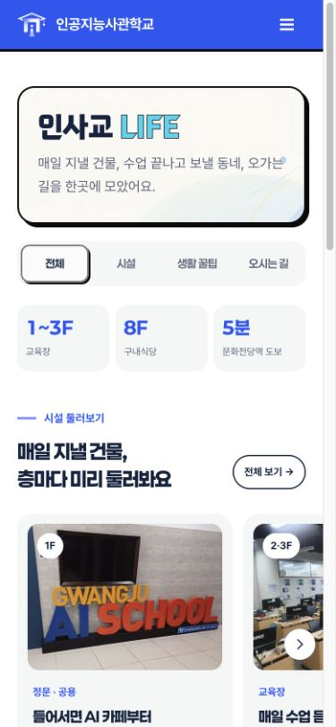
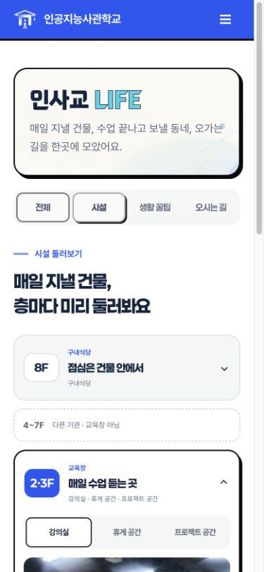
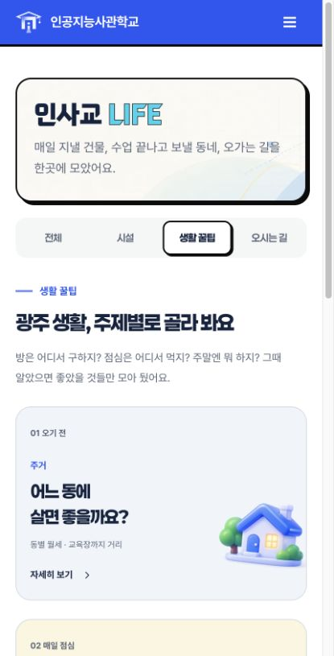
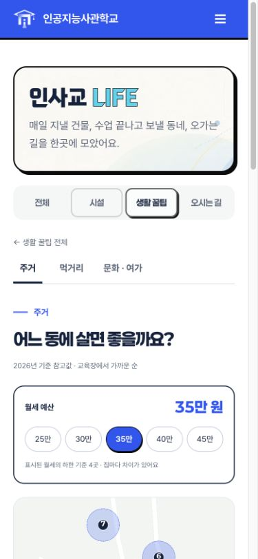
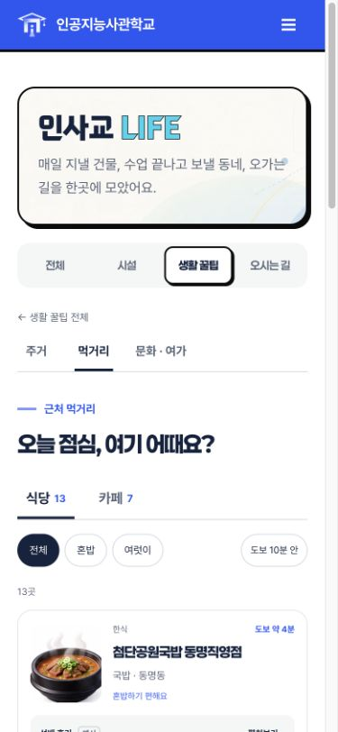
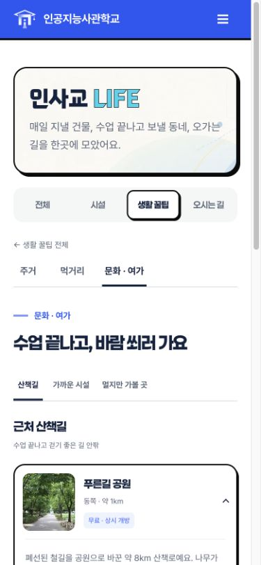
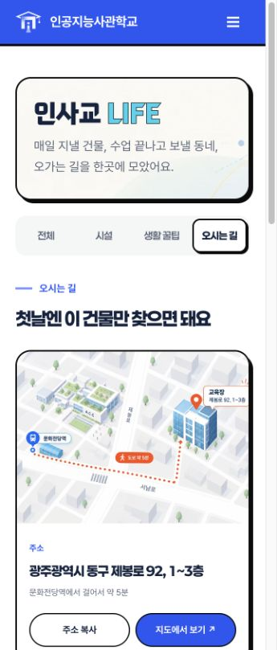
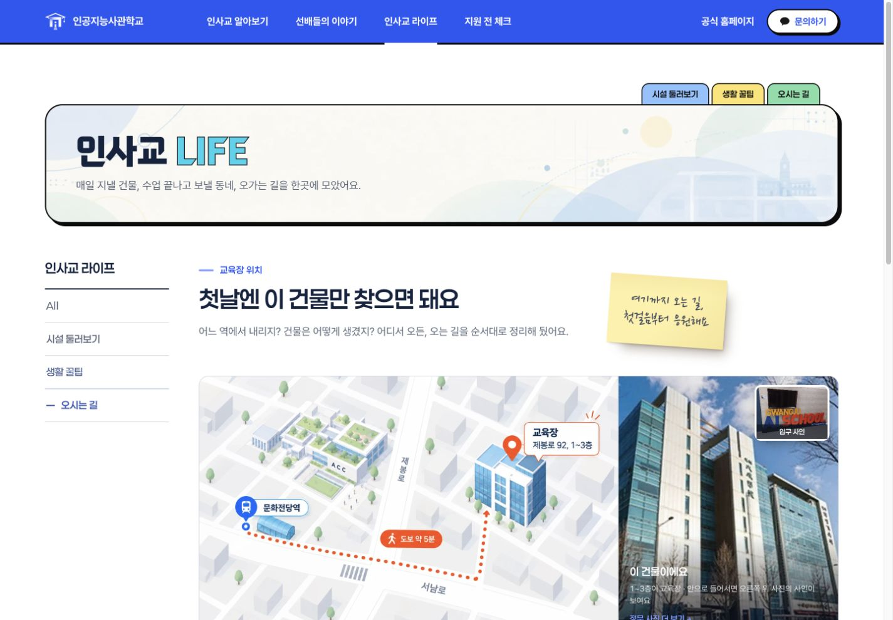
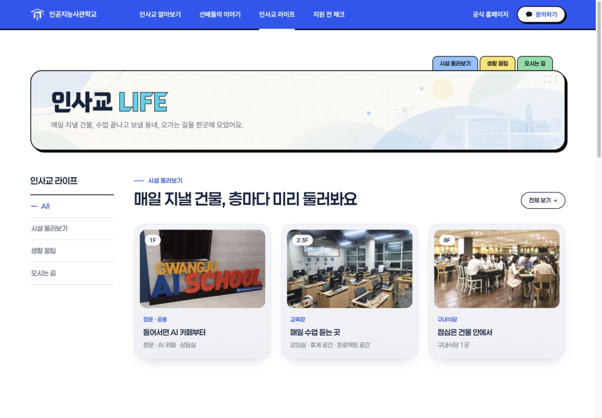

# LIFE 모바일 사이트 반영

별도 시안의 본문 배치를 실제 `life/index.html`의 600px 이하 화면에 적용한다. 헤더·드로어·배너·푸터는 원본 공통 구성과 콘텐츠를 유지하며, 주요 메뉴와 하단 이동 메뉴는 이야기 모바일 화면의 선택 테두리·둥근 배경·버튼 크기를 따른다.

## 구성과 콘텐츠

- 전체: 시설 사진 가로 넘김, 생활 꿀팁 목록, 오시는 길 지도.
- 시설: 층별 접기·펼치기, 공간 선택, 사진 넘김. 원본 안내 링크 유지.
- 생활 꿀팁: 주거·먹거리·문화·여가 카드 및 밑줄 주제 메뉴.
- 주거: 예산 선택, 원본 지도와 7개 동별 카드 연동, 원본 월세·표본·지원 조건.
- 먹거리: 식당 13곳·카페 7곳, 혼밥/여럿·도보 필터, 후기 펼침, 8개씩 페이지 이동.
- 문화·여가: 거리 분류와 장소 설명 펼침.
- 오시는 길: 원본 지도·주소·지도 링크, 건물 사진, 출발지별 경로.

`life/js/life-m.js`는 이미 빌드된 원본 본문에서 콘텐츠를 읽는다. 별도 콘텐츠 사본이나 운영 데이터 연결은 추가하지 않는다. 기존 ID·해시·data 속성 및 데스크톱 라우터는 유지한다. 모바일 지도 복사본은 중복 ID와 원본 패널을 가리키는 ARIA 연결을 제거한다. JavaScript 없이 열면 원본 반응형 화면이 남는다.

## 검증

- `npm run build`, `npm test` (17개 통과), `npm run check`, `node --check life/js/life-m.js`, `git diff --check`.
- 인앱 브라우저: 7개 화면 × 360·390·430px. 가로 넘침·중복 ID·빈 제목·로드 실패 이미지 검사.
- 시설 층 펼침, 공간 선택, 2장/3장 사진 수, 안내 링크 확인.
- 주거 예산 35만/45만에 표시 월세 하한 기준 4곳/6곳, 동 선택·지도 연동 확인.
- 먹거리 2페이지의 5개 항목, 카페 7개, 후기 펼침, 혼자+도보 필터 결과 확인.
- 문화·여가 분류, 출발지 전환, 건물 사진 펼침, 공통 메뉴 열기/닫기 확인.
- 데스크톱 1440px: 7개 화면의 원본과 변경본에서 헤더·배너·왼쪽 메뉴·본문·푸터의 위치/크기/서체/색상 일치 확인.
- 모션 감소 조건은 넘김 애니메이션과 하단 메뉴 전환에 적용. 탭·버튼·요약 요소의 포커스 표시 유지.
- Spring 연동·이야기 선택자·공개 API 계약 변경 없음. Spring 서버 실행 및 DB 실환경은 검증하지 않음.

## 캡처

