# 모바일 화면 후속 보정

600px 이하 모바일 화면의 간격, 카드, 배너, 탭을 보정한다. 원본 템플릿과 페이지 소유 CSS/JS를 수정하고 생성 HTML을 빌드했다. 새 의존성이나 콘텐츠 레코드 변경은 없다.

## 변경

- 알아보기: 소섹션 36px, 제목 아래 16px, 장 구분선 앞 40px. 반복 카드 12px/설명 행 16px. 교육 시간과 하루 일과의 중복 여백 제거. 카카오톡은 웹 채널 카드의 로고·이름·문구를 같은 구성으로 축소. 참여 대상/지원 내용 위 24px, 소제목 아래 14px.
- 이야기/라이프/체크: 모바일 배너의 일반 설명을 숨김. 체크의 굵은 질문 문구 유지. 이야기와 라이프 배너 높이 128px.
- 라이프: 생활 꿀팁 카드에 번호 배지·돌출 이미지·회색 상단·흰색 본문 적용. 번호 제목과 카드 사이 32px, 묶음 사이 48px. 메뉴의 생활 꿀팁 아래 남던 경계선 제거(기존 경계선 규칙은 601px 이상에서 유지).
- 이야기: 인터뷰 목록 제목은 화면에서 숨기되 접근성 이름 유지. 밑줄 탭은 왼쪽 정렬/22px 간격/14px 글씨/3px 선택 선으로 통일. 후기 기수는 둥근 버튼으로 구분.
- 후기: 페이지당 10개. 카드 내부 펼침을 제거하고 기존 `#r-*` 상세 모달로 바로 연결. 원본 카드/모달/필터의 ID와 계약을 보존.

## 검증

- `npm run build`, `npm test` (21개 통과), `npm run check`, JS 구문 검사, `git diff --check`.
- `npm run export:spring -- --output /private/tmp/aica-mobile-polish-spring`: 임시 폴더에 내보내기 성공. 운영 저장소/DB는 변경하지 않음.
- 인앱 브라우저에서 360/390/430px: 알아보기, 이야기 4개 하위 페이지, 라이프 꿀팁/주거, 체크의 가로 넘침·중복 ID 없음.
- 후기 1/2페이지 각 10개, 기수/분류 필터, 카드 클릭과 Enter 모달 열기, Escape/닫기와 포커스 복귀 확인.
- 인터뷰/프로젝트/기수 기록 탭, 알아보기 더 보기/아코디언/후속 프로그램, 꿀팁 상세 링크 확인.
- 이야기 전체와 4개 하위 페이지, 라이프의 배너 128px 및 일반 설명 숨김 확인. 체크 질문은 유지.
- 1440px에서 최신 main과 알아보기·후기·라이프·체크의 대상 영역 크기/패딩/서체 비교. 후기 비교는 글꼴이 로드된 뒤 재확인하여 배너와 원본 격자의 치수 일치.
- 병합된 라이프 경로 복구 보정 유지. `common/js/site.js`, `life/js/life.js`는 이번 PR에서 변경하지 않음.
- Spring 공개 템플릿 내보내기와 자동 테스트까지 확인. Spring 서버/운영 DB 실환경 동작은 미검증.

## 모바일

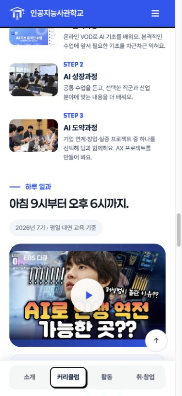
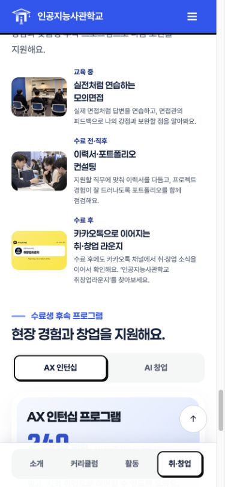
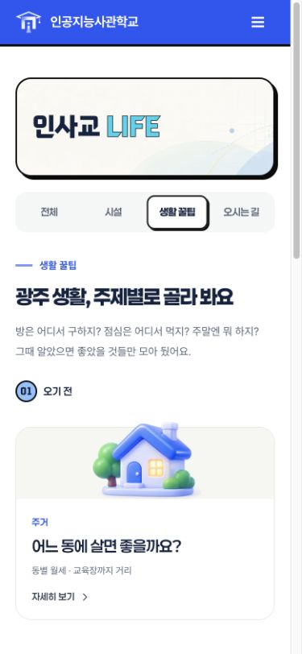
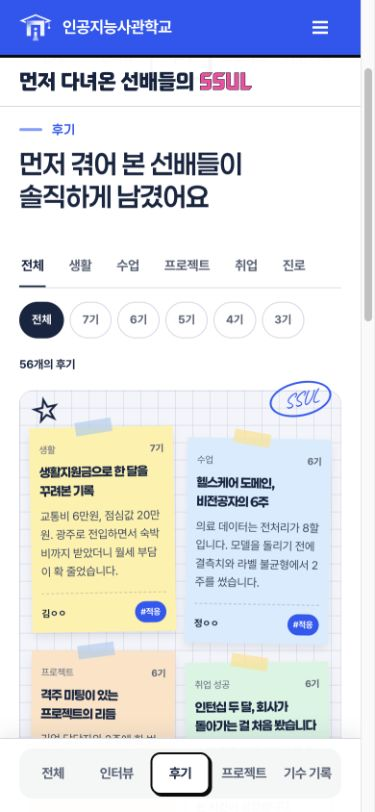
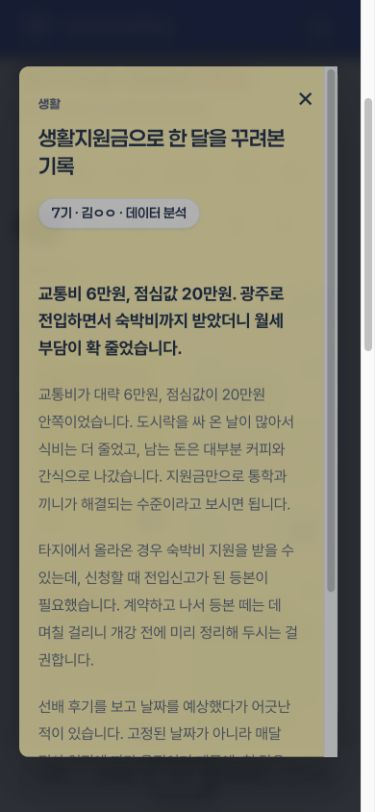

## 데스크톱 비교

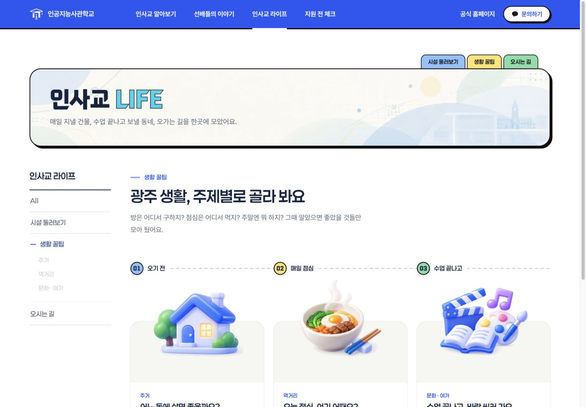
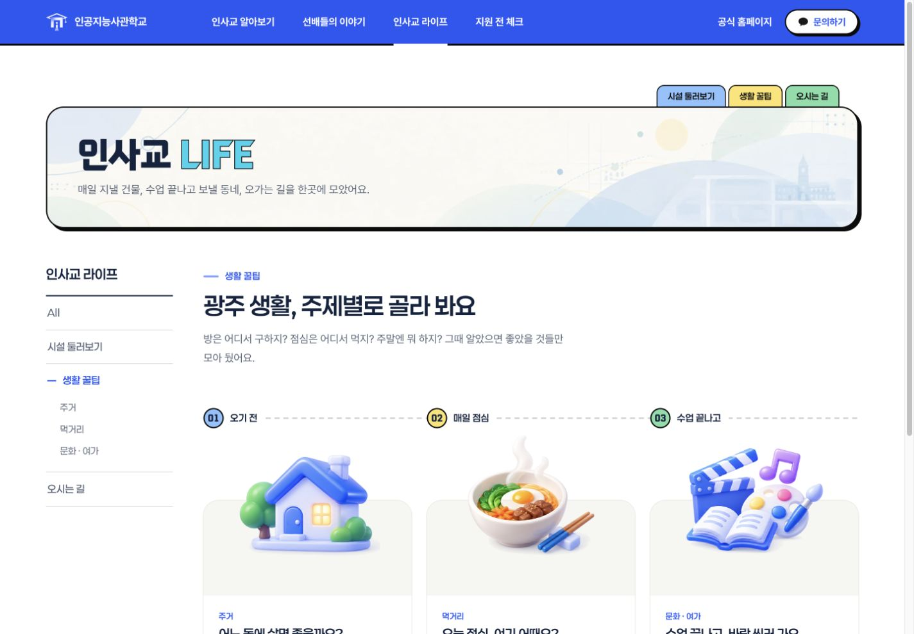

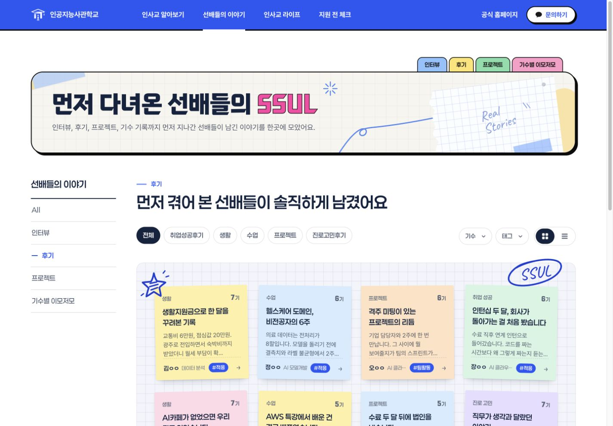

## 배너 추가 보정: 모바일 및 웹

사용자 요청에 따라 이야기·라이프 배너의 배경을 체크 배너와 같은 `#F6F8FC` / 파란 26px 모눈 톤으로 맞췄다. 이야기 모바일에서 숨겨졌던 메모·테이프·손그림 장식을 작은 크기로 표시한다. 라이프에는 도로·건물·공원과 위치 핀으로 구성한 장식용 약도 메모를 추가했다. 실제 위치 안내 지도가 아닌 aria-hidden 장식이며 기존 오시는 길 정보는 유지한다.

라이프 약도 메모는 웹에서도 오른쪽에 확대해서 표시하고 제목·설명 공간을 확보한다. 모바일 128px 배너 높이와 웹 설명 문구를 유지한다. 체크는 추가했던 장식을 제거한 최종 상태로, 이번 추가 커밋에서는 변경하지 않는다. 앞선 데스크톱 비교 기록 이후, 이번 요청 범위의 웹 배너 배경과 라이프 장식은 의도적으로 변경했다.

- `npm run build`, `npm test` 21개, `npm run check`, `git diff --check` 통과.
- 세 페이지를 360·390·430·768·1440px에서 확인: 가로 넘침 없음. 모바일 높이 유지 및 웹 배너 화면 확인.
- 체크리스트의 전형 일정 링크 이동 확인. 배너 장식은 pointer-events:none으로 기존 링크를 가리지 않음.
- Spring 연동 JS·데이터·선택자·발행 계약 변경 없음. 자동 테스트의 공개 템플릿 검증 통과. Spring 서버/DB 실환경은 미검증.

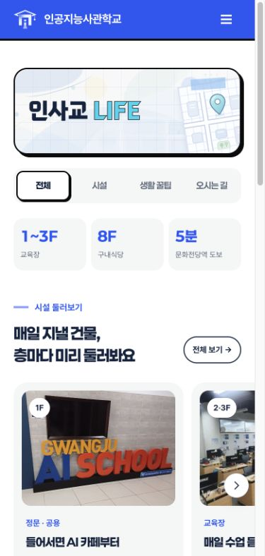
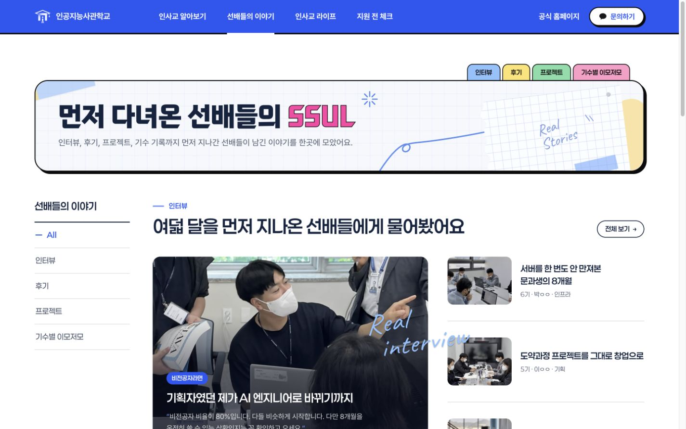
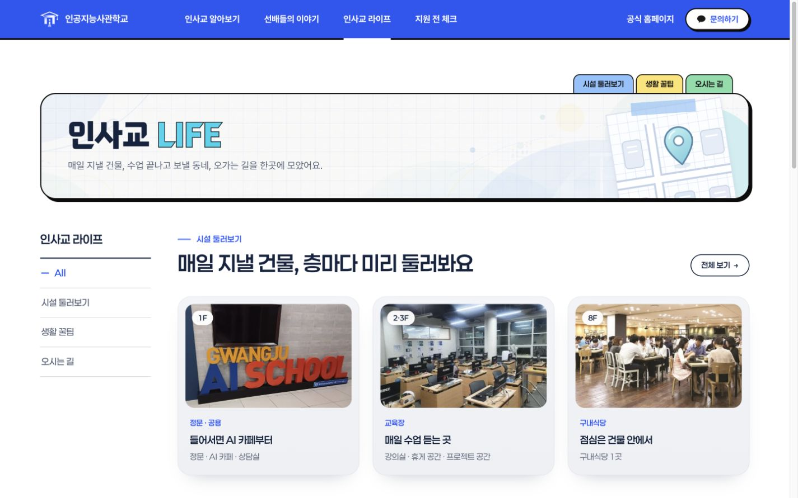
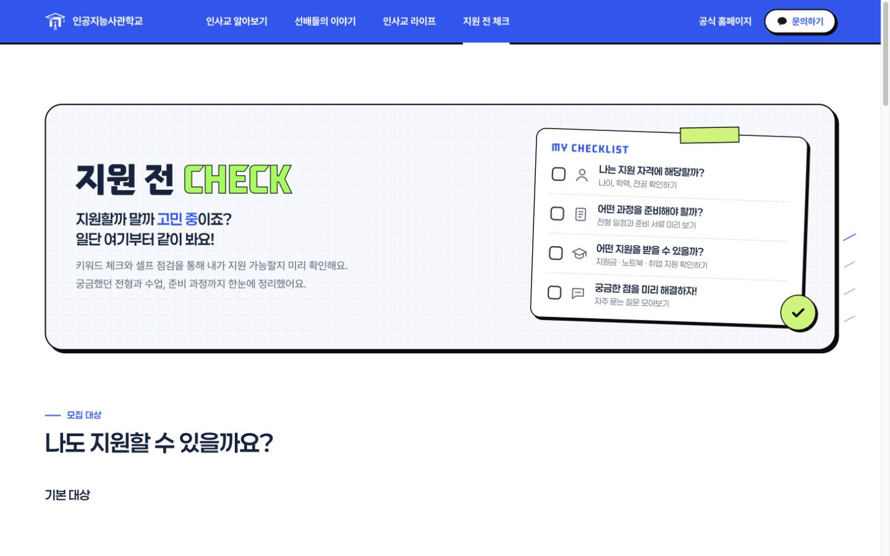

## 체크리스트·탭 최종 조정

- 라이프 문화·여가 모바일 탭의 “가까운 시설”을 “가까운 곳”으로 변경. 데이터와 필터 계약 유지.
- 체크 테이프는 기존 불투명 연두색 유지, 검은 테두리 제거 및 양 끝을 불규칙하게 찢긴 모양으로 변경. 웹·모바일 공통.
- 600px 이하에서만 체크리스트 카드 회전 제거, 오른쪽 아래 원형 체크 장식 숨김. 웹의 2도 회전과 원형 체크 유지.
- 360·390·430px 및 1440px 스타일·가로 넘침 확인. 모바일 “가까운 곳” 탭 전환 확인.
- build / test 21개 / check / diff --check 통과. 데이터·Spring 연동 JS·DB 계약 변경 없음. Spring 실환경은 미검증.

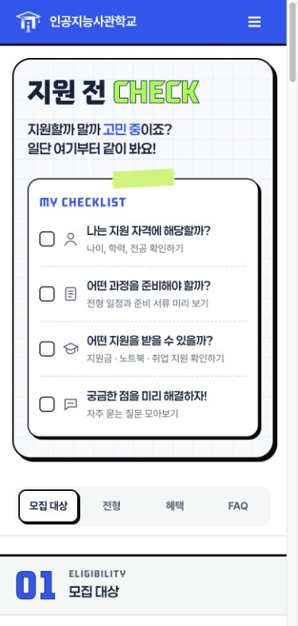
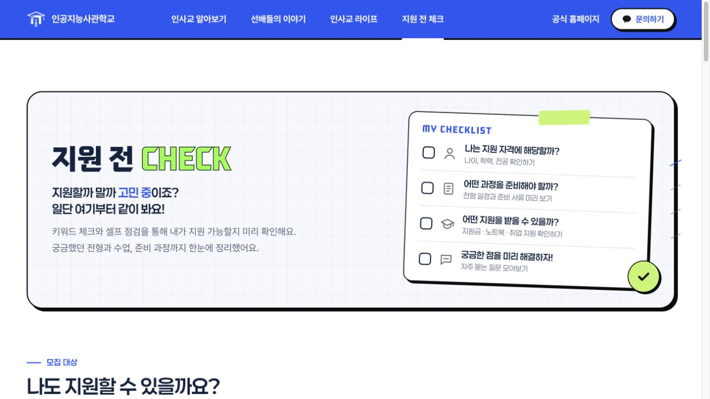
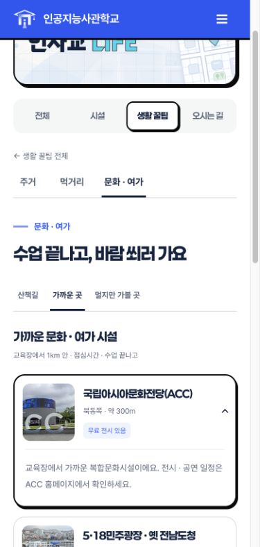
