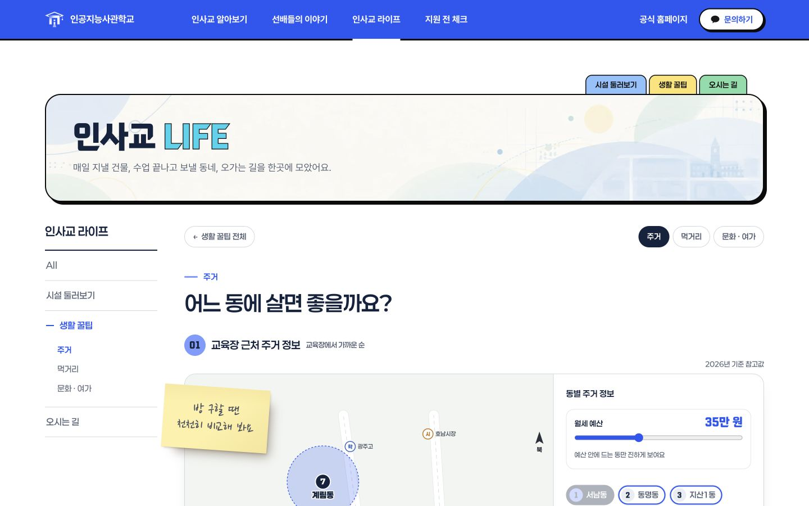
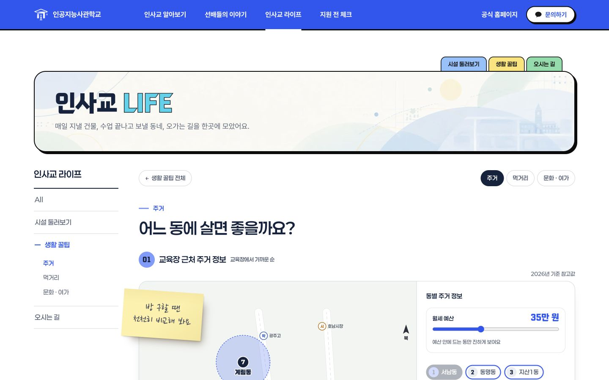
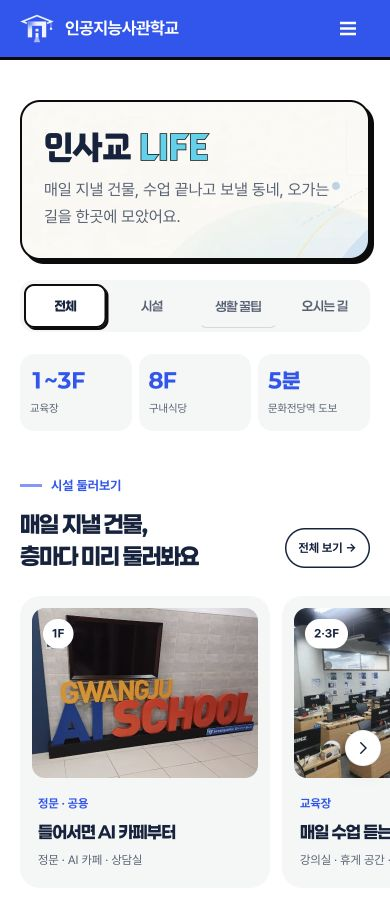

# PR #10 통합 검수와 라우팅 보완

기준 main은 `f5c3a1b`, 검토한 팀원 변경은 `27e0f94`까지이다. 라이프 모바일 7개 화면과 알아보기 모바일 간격 보정을 보존하고, 통합 검수에서 발견한 두 회귀를 수정했다.

## 수정한 문제

- 데스크톱 `#tp-house`, `#tp-food`, `#tp-fun` 직접 진입 시 허브가 보이던 문제: 주제 초기화를 LNB 생성과 분리하고, LNB 대상은 표시 문구 대신 `data-sub="tips"`로 찾는다. 모바일용 문구 span이 있어도 데스크톱 하위 메뉴와 주제를 유지한다.
- 잘못 인코딩된 `#%E0%A4%A`에서 모바일 본문이 비던 문제: 공통 `Site.decodeHash()`가 잘못된 해시를 기본 화면으로 처리한다. 모바일 본문은 렌더링과 이벤트 연결이 성공한 뒤 원본을 숨긴다. 정상 UTF-8·기존 해시 주소는 유지한다.
- 라이프 원본 HTML의 JS 캐시 버전을 갱신하고, 페이지 모바일 CSS를 공통 모바일 메뉴 CSS 앞에 둔다. 생성 HTML도 다시 빌드했다.

## 재검증 결과

- `npm run build`, `npm test` 21개, `npm run check`, 관련 JS 문법 검사 통과. 회귀 테스트 4개는 실제 공통/Life 라우터로 세 직접 주소·LNB 부재·복제된 메뉴 문구·정상/잘못된 해시를 확인한다.
- 라이프 7개 경로를 1280·1440px에서 main과 비교했다. 표시 문구·글꼴·색·배경·본문 배치를 유지하고 데스크톱 세부 주제와 하위 메뉴가 표시된다. 고정 헤더는 화면 좌표, 본문은 문서 좌표로 비교해 해시 이동의 스크롤 차이를 제외했다.
- 모바일 360·390·430px의 7개 정상 경로 및 잘못된 해시: 본문 표시, 가로 넘침·중복 ID·표시 이미지 로드 실패 없음.
- 시설 단일 층 펼침·공간 선택·사진 2/3, 주거 예산 25만·동/지도 양방향 및 Enter 선택, 식당 13곳→2페이지 5개·카페 7곳→혼자/10분 필터 4곳·후기 Enter 펼침, 문화 분류·출발지 변경, 공통 드로어 열기/닫기를 확인했다.
- 알아보기: 360·390·430px 카드 높이 일치, 열린 아코디언 아래 실제 여백 20px, 프로젝트/활동 사진 화살표 중심 차이 0px, 갤러리 넘김을 확인했다. 1280·1440px의 정적 배치·서체·색은 main과 같다. 기존 반복 애니메이션의 시점 차이는 레이아웃 비교에서 제외했다.
- `/aica-site-preview/` 하위 경로의 라이프 메뉴·CSS·JS·먹거리 목록을 확인했다.

## Spring 확인 범위

내보낸 템플릿과 후기/이야기 시드는 main과 바이트 동일하다. 별도 Spring 실행에 후보 프론트와 임시 내보내기 템플릿을 사용하고, 새 H2 메모리 DB에 시안 데이터를 가져왔다. 라이프·이야기 공개 페이지 5종과 공개 API 4종은 모두 200이었다. 브라우저에서 Spring 라이프의 데스크톱 직접 주제와 모바일 잘못된 해시 복구, DB 후기의 모바일 취업 필터(5개)와 본문 펼침도 확인했다.

`r-*`, `iv-*`, `q-*`, `pj-*`, live JS/CSS와 발행본 조회 경계는 변경하지 않았다. 임시저장/발행 코드는 기존 정책을 유지한다. 실제 운영 DB와 관리자 발행 시나리오는 이번에 다시 실행하지 않았으며, 별도 백오피스 저장소·기존 DB·실행 중인 서버에는 내보내거나 덮어쓰지 않았다.

## 비교 캡처

