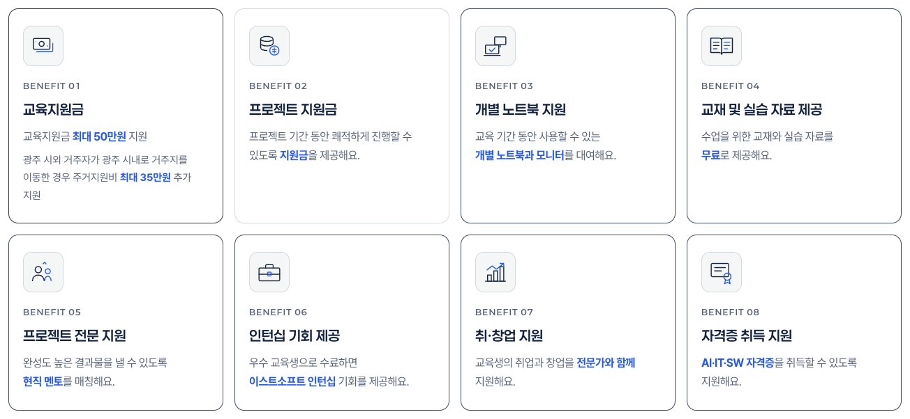
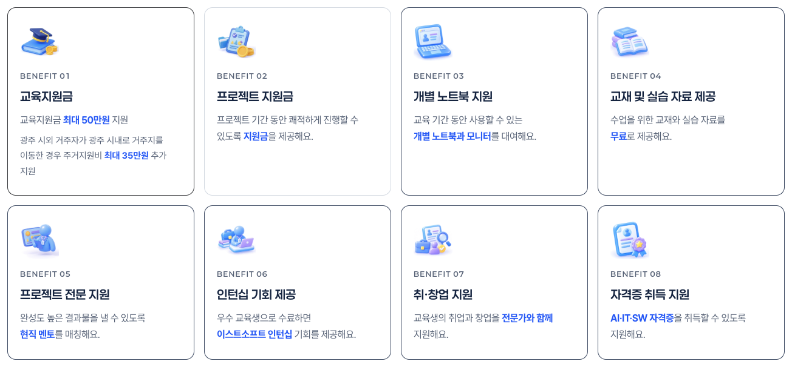
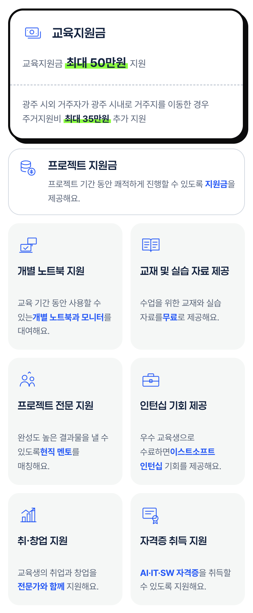

# 지원 전 체크 지원 혜택 아이콘 교체 비교

기준: `main`(d87b4ac) / 작업: `claude/project-thread-1oior1`. 2026-10-20, 로컬 정적 미리보기를 헤드리스 Chrome으로 같은 폭에서 찍었습니다(움직임 줄이기 설정, 모바일은 고정 헤더 · 아래 고정 탭을 숨기고 카드 영역만).

| 폭 | 변경 전 | 변경 후 |
| --- | --- | --- |
| 1440px |  |  |
| 390px |  |  |

- 1440px: 58px 회색 상자 선 아이콘 → 64px 3D 그림. 카드 높이는 약 2px 늘어남.
- 390px: 32px 선 아이콘 → 44px 3D 그림. 위 두 카드의 아이콘 칸도 44px.
