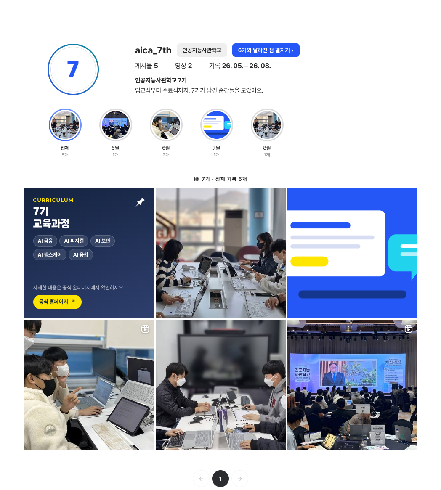
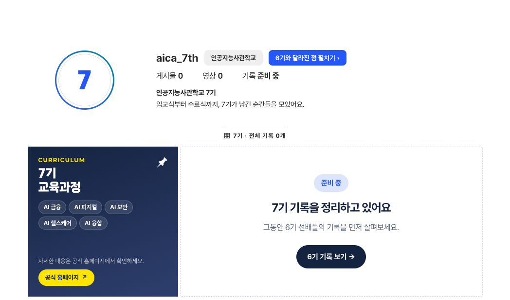
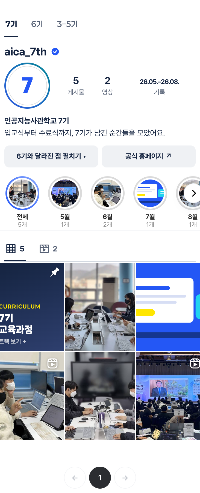
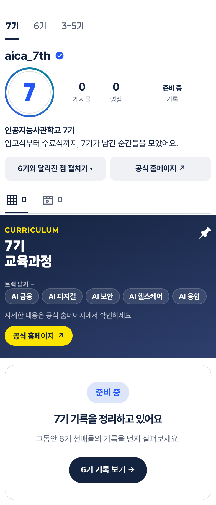

# 기수별 이모저모 7기 준비 중 화면 비교

기준: `main`(5ff4a01, PR #16~#19 병합 후) / 작업: `fix/stories-cohort7-upcoming`. 2026-10-20, 로컬 정적 미리보기를 헤드리스 Chrome으로 같은 폭에서 찍었습니다(움직임 줄이기 설정, 고정 헤더 · 띠 · 아래 탭 숨김, `#cv3` 영역만).

| 폭 | 변경 전 | 변경 후 |
| --- | --- | --- |
| 1440px |  |  |
| 390px |  |  |

- 변경 전: 7기에 더미 게시물 5개(게시물 5 · 영상 2 · 기록 26. 05. – 26. 08.)와 달별 동그라미.
- 변경 후: 7기 칩 · 프로필 · 6기와 달라진 점 · 교육과정 칸은 그대로, 게시물 0 · 영상 0 · 기록 준비 중, 달별 동그라미 · 쪽 번호 숨김, 교육과정 칸 옆(모바일은 아래)에 준비 중 판.
- [6기 기록 보기 → 를 누른 뒤 1440px](after-1440-6th.png): 6기 칩으로 바뀌고 6기 기록 5개가 보임.
