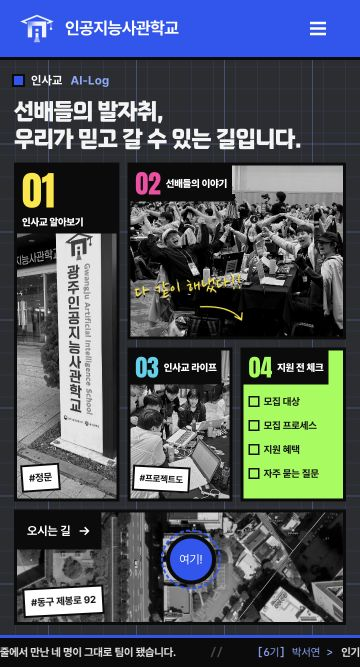
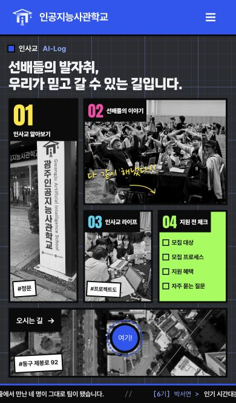
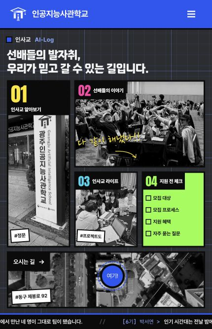
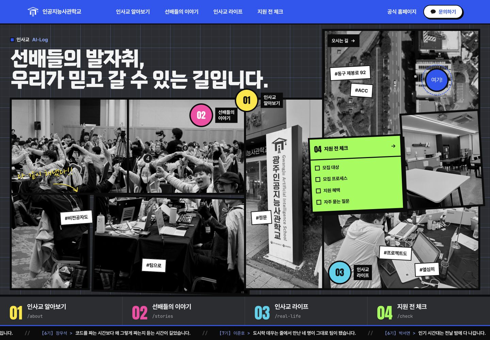

# 모바일 랜딩 모자이크 적용 검증

기준: 2026-10-16 origin/main cc1d10b (PR #12 병합본). 작업 브랜치 codex/mobile-landing-mosaic.

사용자가 선택한 한 화면 랜딩 4안에서 01 입구 사진을 왼쪽 두 행에 배치했습니다. 오른쪽 위는 이야기, 오른쪽 아래는 라이프·지원 전 체크, 하단은 지도입니다. 기존 이미지, 문구, URL, 해시와 공통 헤더를 재사용합니다. 모바일 랜딩의 860px 이하 CSS만 변경했습니다. 앞서 요청한 PC 지도 HEADQUARTER 문구 삭제를 원본 템플릿과 생성 HTML에 포함했습니다.

## 검증

- npm run build: 생성 11개 성공
- npm test: 32개 통과
- npm run check: 생성 결과 11개 일치
- 기존 npm run preview 서버 http://127.0.0.1:4173 재사용
- 실제 브라우저 360·390·430px 너비 / 높이 667px: 메뉴 4개와 지도 첫 화면 노출, 가로 넘침 없음, 지원 전 체크 4개 항목 카드 안 노출
- PC 1440×1000: 기존 포스터 배치 확인
- 모바일 메뉴 열기 및 Escape 닫기, 메뉴 버튼 포커스 복귀 확인
- 키보드 Tab 이동 후 라이프 카드 포커스 표시 확인
- 지원 전 체크 FAQ 링크 클릭 후 /check/index.html#faq 도착 확인
- 기존 모션 감소 규칙과 URL·data-* 연결은 유지. 기기별 터치 자동 강조 및 실제 모션 감소 환경은 추가 수동 확인 대상.

## 화면

## 범위와 제한

이 저장소의 원본 CSS와 템플릿에 적용했으며 비교용 시안 디렉터리는 PR에 포함하지 않습니다. main 병합·배포는 수행하지 않습니다. Spring 이야기 마크업·API·내보내기에는 변경이 없고 Spring 서버 실행은 별도로 검증하지 않았습니다. 아주 낮은 화면 및 글꼴 확대 시에는 가독성을 위해 페이지 스크롤이 생길 수 있습니다. 푸터는 첫 화면 아래에서 스크롤로 접근합니다.
