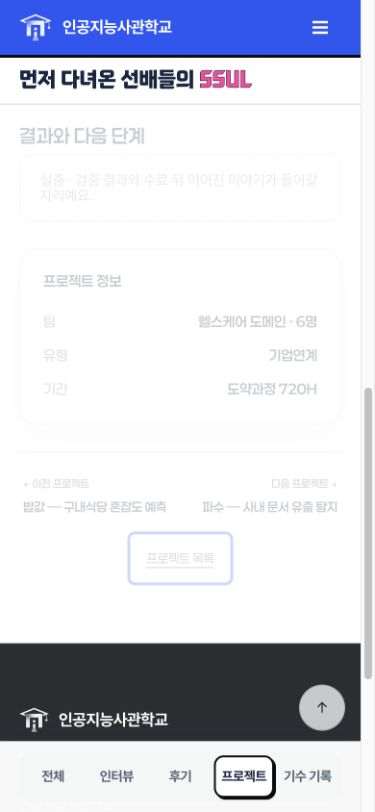
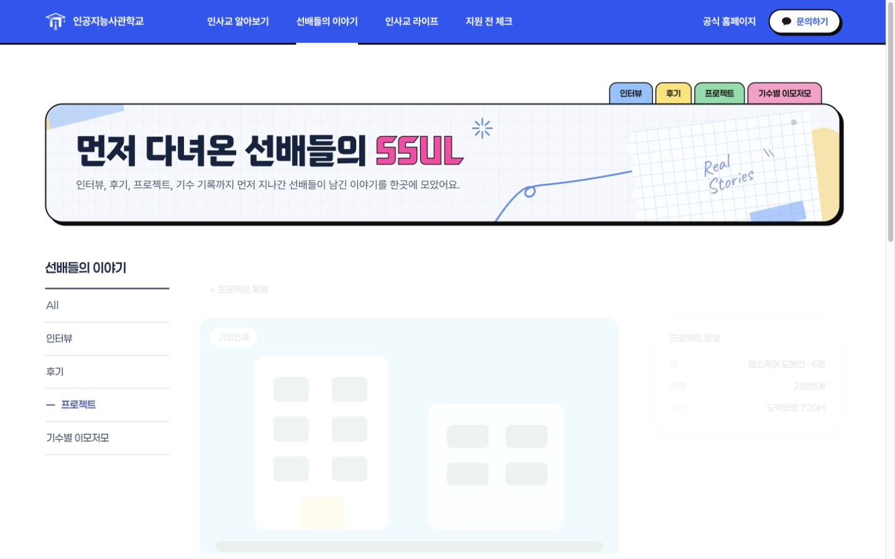

# PR 14 프로젝트 유형 필터 수정 검증

사용자가 PR 13·14의 디자인 변경과 검증 후 main 병합·외부 공유본 갱신을 승인했다. PR 14 원본 head `9b813682431eec3a8455b3ba38b6b2a46cbf6da8`에서 확인한 필터 불일치를 수정했다.

## 수정 내용

- 모바일의 기업연계·실증·창업 선택에 맞는 공개 카드만 이전/다음 탐색에 포함한다. 예를 들어 기업연계는 `pj-2 → pj-3 → pj-6`이다.
- 첫 글·마지막 글의 해당 방향과 한 개뿐인 유형의 양방향을 비활성 안내로 유지한다.
- 유형과 앵커는 서버가 렌더링한 카드에서 읽으므로 DB 글 ID와 새 유형을 하드코딩하지 않는다.
- 데스크톱에서는 숨겨진 모바일 필터를 적용하지 않는다. 600px 경계를 넘으면 현재 상세의 탐색을 다시 계산한다.
- 기존 디자인·마크업·공개 API·발행 정책은 변경하지 않았다. 브라우저가 수정된 JS를 받도록 원본 head partial의 캐시 버전을 갱신하고 생성물을 다시 빌드했다.

## 확인 결과

- `npm run build`, `npm test` 37개, `npm run check`, `git diff --check` 통과.
- 실제 배포 JS를 실행하는 새 회귀 테스트 4개는 수정 전 코드에서 모두 실패하고 수정 후 모두 통과했다. 유형별 양끝·한 개 결과·전체·DB형 앵커·신규 유형·데스크톱 전환을 검증한다.
- PR 13과 수정된 PR 14를 합친 임시 checkout에서도 빌드·37개 테스트·생성물 검사·Spring 내보내기가 통과했다.
- 인앱 브라우저에서 모바일 360·390·430px 각각 전체·기업연계·실증·창업 탐색을 확인했다. [정적 화면 12조합](fixed-project-flows.json), [600px 경계 전환](fixed-breakpoint-flows.json).
- 통합본 홈·후기·인터뷰·프로젝트 목록은 360·390·430·1280·1440px의 20조건에서 문서 가로 넘침과 표시된 이미지 깨짐이 없었다.
- `/aica-site-preview/` 하위 경로에서 공통 메뉴 열기·Escape·포커스 복귀, FAQ 실제 도착, 필터를 적용한 프로젝트 상세 링크를 확인했다. [결과](combined-prefix-flows.json).
- 별도 Spring 서버와 메모리 H2에 최초 시안 데이터를 가져와 5개 이야기 페이지와 공개 API를 확인했다. [프로젝트 필터 탐색 12조합](spring-project-flows.json), [데스크톱 2조건·후기 포커스·인터뷰 기수 필터 6흐름](spring-extra-flows.json) 통과. 콘솔 경고·오류가 없었다.
- Spring 내보내기 결과는 통합본과 PR 14 수정본이 같았다. 공개 쿼리·작업본/발행본 정책은 이번 프론트 수정 범위 밖으로 유지했다.
- 백오피스 코드를 임시 폴더에 복사한 뒤 메모리 H2에서 `ReviewPublishingWebTest`와 `StoryPublishingWebTest`를 실행해 22개 모두 통과했다. 임시저장 비공개·명시적 발행·권한·충돌·복원 등 기존 발행 경계를 재검증했다. 실행 환경은 테스트 전용 Java 27/JUnit 1.11.4이며 운영 JVM·DB를 변경하지 않았다.

실제 운영 DB, 다른 작업자의 백오피스 소스·DB·업로드 및 기존 실행 서버를 검증 데이터로 교체하지 않았다. 물리 터치 기기와 스크린리더는 이번 검증에 포함하지 않았다. 배포되는 GitHub Pages는 정적 공유 시안이며 Spring 검증은 별도 격리 환경에서 수행했다.
