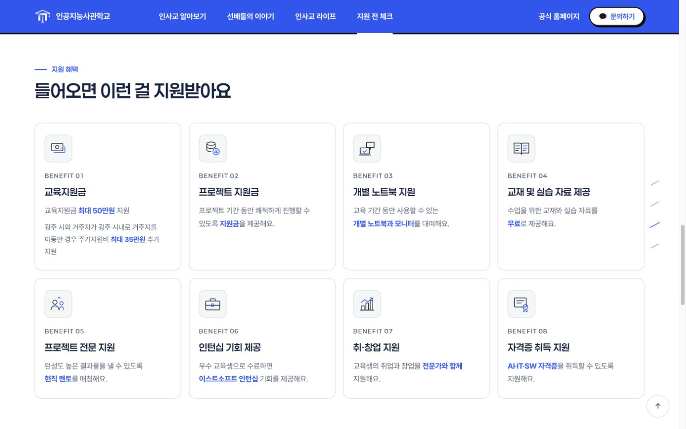
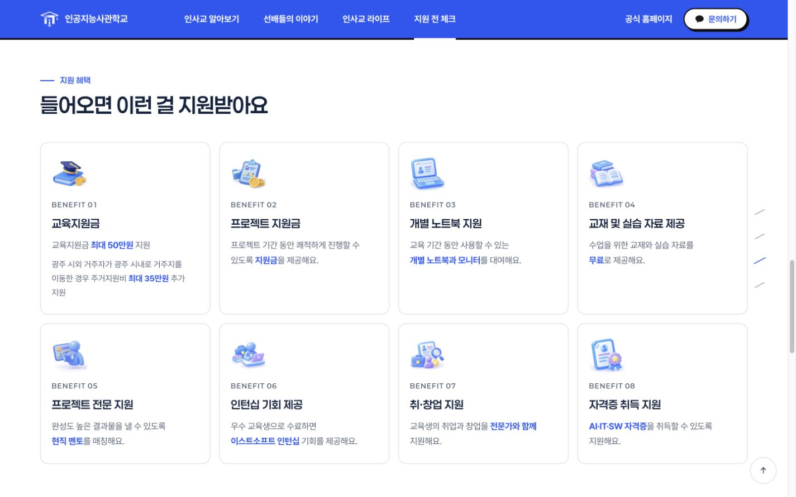
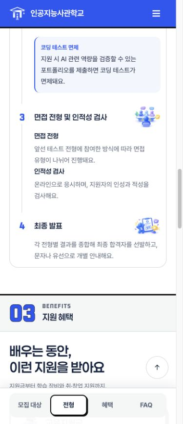
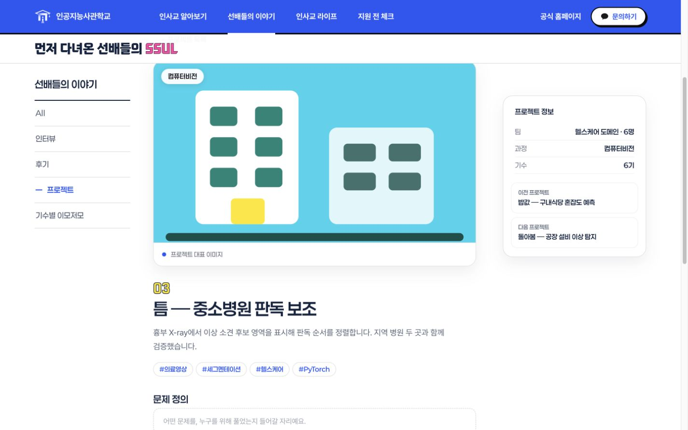
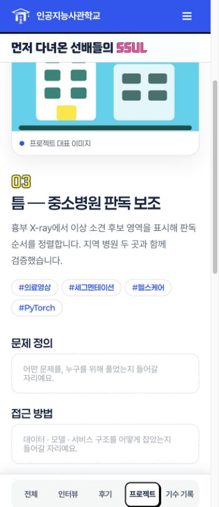

# PR16–19 통합 검증 · 2026-10-20

기준 main은 d87b4acc. PR17·18·19의 이력을 기존 PR16 브랜치에 병합하고, PR16의 DB 발행본 필터 계약을 함께 보존했다. PR18의 데스크톱 혜택 아이콘 변경은 소유자가 진행 승인한 범위에 포함된다.

- 반 정보가 없던 pj-3·pj-6은 정적 상세에서 확인된 기수만 표시한다. 다른 프로젝트의 기존 팀 반 정보는 유지한다.
- Spring은 공개 cohort/subject만으로 필터를 만들고 상세 과정은 subject→type, 기수는 cohort→기존 duration 순으로 표시한다. 반 번호는 저장 규격에 추가하지 않는다.
- 인터뷰·프로젝트 하단 탐색을 본문 그리드 다음 형제로 배치하며 프로젝트 sidebar와 같은 필터 집합을 사용한다. 모바일에서는 중복 sidebar 탐색만 숨긴다.
- 혜택 아이콘 8개, 먹거리 주사위 초기화 SVG와 문화 카드 높이 수정을 함께 포함한다.

## 검증

- frontend build/test49/check/export:spring 및 diff-check 통과.
- private 통합 candidate에서 npm run verify clean/JAR 성공: 루트 Node3+frontend49, Java83 모두 통과. 첫 검증이 기존 글의 기간 DTO key 오류를 잡아 실제 공개 키 duration으로 수정했고, 수정 후 전체 재검증했다.
- 정적 56개 화면 조합(main 비교1280/1440 및 통합360/390/430/1280/1440), 실제 Spring 프로젝트·인터뷰 상세10개 화면 조합에서 가로 넘침·깨진 이미지 없음. 공통 body 폰트/색상/배경과 헤더 높이가 main 대비 동일하다.
- 6기·컴퓨터비전 필터 후 pj-1↔pj-3으로 sidebar·하단 탐색이 일치한다. 모바일3너비에서 sidebar 탐색 숨김/하단 이동 유지, 공통 메뉴 열기/닫기 확인. 문화 카드4개 높이343px 일치.
- 새 별도 H2 seed86(후기56·인터뷰7·프로젝트6·기수기록17), import=false 재기동 및 SSR5페이지 HTTP200 확인.
- 별도 HTTP fixture DB에서 임시저장 B 동안 공개본 A 유지, 재발행 C 때 제목/기수/과정 반영을 확인했다. 98기 비공개 분류 미노출, legacy 유지, 60자 과정, 악성 텍스트 HTML escape 확인. SUPPORT·복원·권한은 Java 회귀 검증에 포함된다.
- 팀원 작업 폴더·조직 저장소·실제 DB·기존 서버에는 쓰지 않았다. 실제 운영 배포/운영DB, Windows·물리기기·스크린리더는 미검증이다. GitHub Pages 공유본은 정적 시안이며 실제 DB 화면이 아니다.

## 비교 캡처

