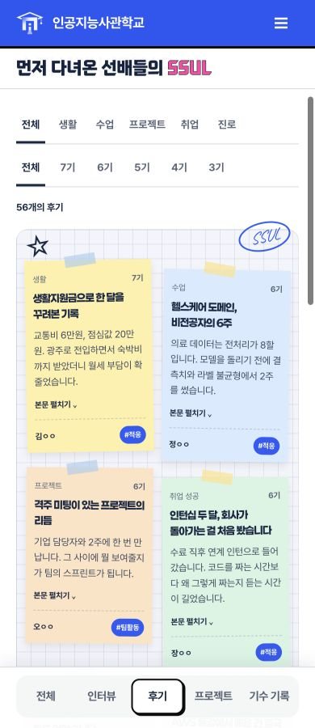

# PR #7·#8 통합 검수

2026-10-16, 기준 main `18df845761b0e081a9ce574e47b27293b0b23bd6`. PR #8 `1a73c55`의 CSS 분리와 PR #7 `2231baa`의 모바일 변경을 합친 격리 미리보기에서 검수하고, 아래 필터 결함을 수정했습니다.

## 수정한 결함

취업·진로 카드는 `cat-career cat-job` 또는 `cat-career cat-path`처럼 공통 분류가 먼저 옵니다. 첫 `cat-*`만 읽던 코드 때문에 취업 5개와 진로 3개가 각각 0건으로 표시됐습니다. 선택한 세부 분류가 전체 클래스에 있는지 검사하도록 수정했습니다.

`tests/mobile-reviews.test.mjs`는 실제 배포할 JS를 최소 DOM 경계에서 실행해 취업·진로·생활, 기수 교차 필터와 빈 결과/복귀를 검사합니다. 같은 테스트가 수정 전에는 실패하고 수정 후에는 통과하는 것을 확인했습니다. 이야기 원본 5페이지와 생성본의 모바일 CSS/JS 버전도 `1016review`로 갱신했습니다.

## 검증 결과

| 범위 | 결과 |
| --- | --- |
| 코드 | PR #7 단독 테스트 13개, #8과 통합 시 16개 통과. build/check 생성물 11개 일치, JS 문법·diff 검사 통과 |
| 데스크톱 | 이야기 5개 페이지를 1280·1440px에서 main과 비교. 배치·서체·색상 회귀 없음. 대표 후기/기수 기록 PNG 동일 |
| 모바일 | 이야기 5개 페이지를 360·390·430px에서 확인. 가로 넘침·중복 ID·깨진 이미지 없음 |
| 후기 | 각 모바일 폭에서 취업 5개·진로 3개 표시. 생활+7기 5개, 진로+3기 빈 결과, 키보드 본문 펼침, 상세 열기/닫기, 전체 2페이지 이동, 기존 `#tg-4` 23개 필터 확인 |
| 프로젝트 | 유형 필터, 하나만 열리는 아코디언, 기존 `#pj-*` 상세와 목록 복귀 확인 |
| 인터뷰·기수 | 다음 인터뷰 넘김, 카드/화살표 중심 일치, 제목 Paperlogy, 기간 한 줄 표시 확인 |
| 화면 전환 | 데스크톱 취업 필터→모바일→데스크톱 왕복에서 5개 유지, 모바일 전용 UI 숨김 확인 |
| 공유 경로 | `/aica-site-preview/` 하위 경로에서도 후기 필터·새 자산 동작, 콘솔 오류 없음 |

## Spring

기존 컴파일된 Spring 앱을 새 H2 메모리 DB와 임시 내보내기 폴더로 실행했습니다. 발행 시드가 있는 경우 공개 페이지 5개·API 4개·새 자산이 HTTP 200이고, 빈 DB에서는 5개 페이지/4개 API가 정상 응답하며 API 결과가 빈 배열인 것을 확인했습니다.

브라우저에서 Spring 후기의 취업·진로 필터(5/3개), 2페이지, 본문 펼침·상세/닫기와 프로젝트 아코디언을 확인했습니다. seed JSON은 기준본과 바이트 동일하며, 기존 ID·선택자·발행본 조회 정책을 유지합니다.

기존 로컬 DB·8082 서버·백오피스 저장소는 수정하지 않았습니다. 운영 DB와 실제 백오피스에서 임시저장→발행하는 전체 시나리오는 이번 검증 범위에 포함하지 않았습니다. 확인한 범위에서 남은 병합 차단 결함은 발견하지 못했습니다.

## 캡처

| 화면 | main 기준 | 통합본 |
| --- | --- | --- |
| 후기 1440px | [기준](1440-stories-reviews.html-baseline.png) | [통합](1440-stories-reviews.html-candidate.png) |
| 기수 기록 1280px | [기준](1280-stories-cohorts.html-baseline.png) | [통합](1280-stories-cohorts.html-candidate.png) |

[모바일 프로젝트](projects-mobile-390.png)

## 기존 Spring 템플릿 호환 보완

통합 후 기존 8082 서버가 예전 `/common/css/unify.css` 링크를 계속 사용하는 것을 추가 확인했습니다. 이 경로를 공통·이야기 CSS의 `@import` 진입 파일로 복원해, 이전 템플릿도 분리된 원본을 그대로 읽게 했습니다. 새 페이지/내보내기는 계속 각 CSS를 직접 불러옵니다.

8082의 이야기 5개 페이지를 390·1440px에서 열어 두 import가 모두 로드되고 가로 넘침·콘솔 오류가 없는 것을 확인했습니다. 경로 회귀 테스트를 추가해 최종 17개 테스트·build/check가 통과했습니다. [기존 Spring 후기 화면](legacy-spring-reviews-1440.png).

기존 Spring의 템플릿 자체는 변경하지 않았으므로, 새 모바일 목록까지 적용하려면 최신 내보내기 템플릿을 Spring 배포 과정에서 반영해야 합니다. 이 호환 파일은 그 전에도 기존 디자인이 깨지지 않게 유지하는 경계입니다.
