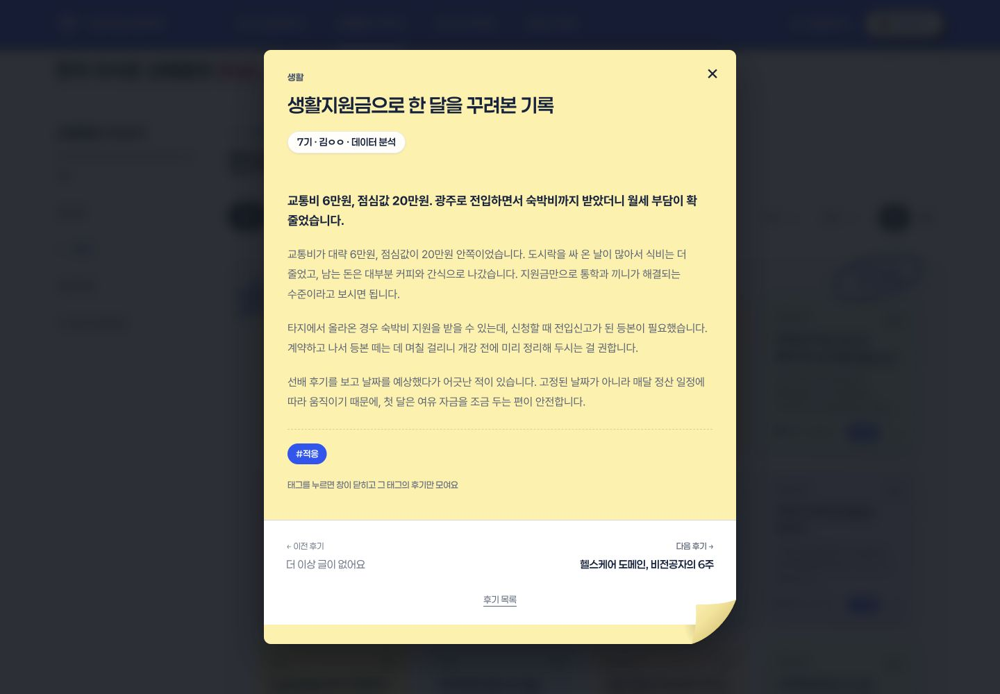
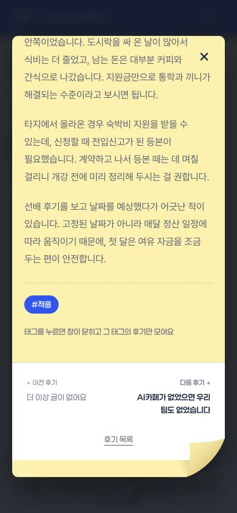
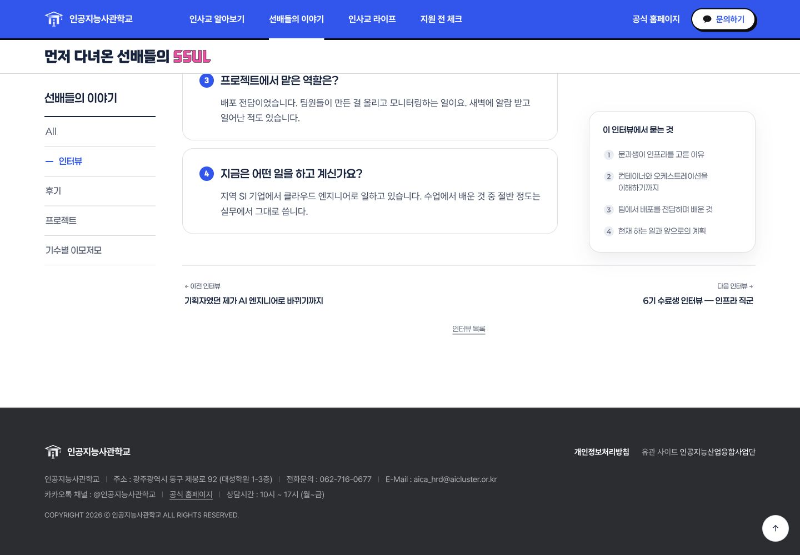
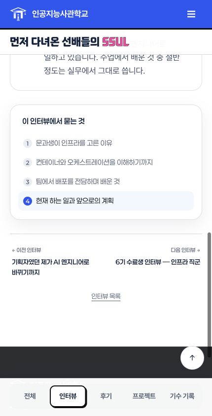
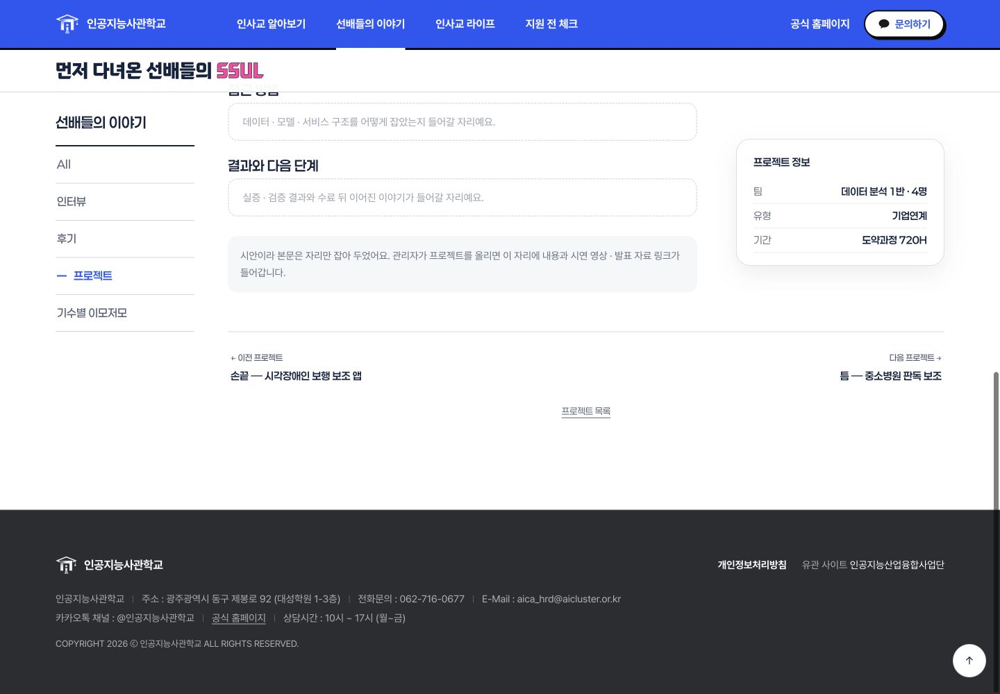
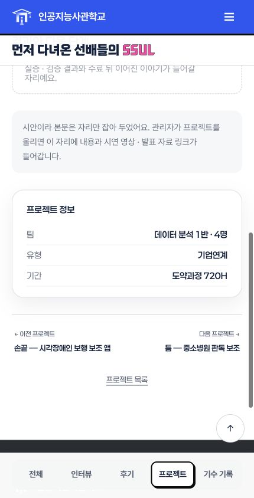

# 공통 상세 탐색: 간결한 좌우 링크형

최신 origin/main cc1d10b 기준, codex/story-detail-navigation 브랜치의 로컬 원본에 적용했습니다. 랜딩 PR #13과 분리한 작업입니다. 아직 PR 생성·main 병합·배포는 하지 않았습니다.

후기 모달·인터뷰·프로젝트의 본문 끝에 이전/다음 제목과 목록 복귀 링크를 통일했습니다. 인터뷰·프로젝트는 부가 정보 다음에 배치합니다. 기존 프로젝트 사이드 탐색은 공통 탐색이 준비되면 숨기며, 레거시 원본 슬롯은 Spring 템플릿 호환을 위해 유지합니다.

페이지에 이미 렌더링된 공개 카드와 상세 제목을 읽어 탐색을 만들고, 텍스트는 textContent로 삽입합니다. 정적 자료와 Spring 발행본 모두 같은 경로를 사용합니다. 첫/마지막 글에서는 이동할 수 없는 방향을 링크가 아닌 비활성 안내로 표시합니다. 후기 카테고리·기수·태그, 인터뷰 기수 선택에 맞는 카드 순서로 이동합니다. 목록 복귀 시 필터 상태와 원래 스크롤 위치를 보존합니다.

## 검증

- npm run build / npm run check 성공, npm test 33개 통과
- 기존 4173 preview 서버 재사용
- 후기·인터뷰·프로젝트 모두 360·390·430px에서 페이지·탐색 가로 넘침 없음
- PC 1440px 실제 화면 확인
- 프로젝트 다음 글 이동과 마지막 글 다음 비활성 확인
- 인터뷰 다음 글 이동 및 제목 포커스 확인
- 후기 생활 필터에서 다음 후기 #r-life-1 연결 확인
- 후기 다음 이동 후 모달 스크롤 초기화 및 닫기 단추 포커스 확인
- 후기 이동 후 Escape 닫기, 원래 카드 포커스 복귀 확인
- 목록 복귀 링크와 키보드 포커스 표시 확인
- Spring 내보내기 3종 페이지에 CSS/JS 링크가 포함되는 회귀 테스트 추가
- 모달 이동 후 원래 카드 포커스가 보존되는 회귀 테스트 추가

## 화면

## 확인 범위

Spring 실행 환경은 구동하지 않았으며 내보내기 템플릿과 자산 경로만 테스트했습니다. 다른 저장소·DB에는 내보내지 않았습니다. 기존 해시·선택자·RichText 검증·모션 감소 규칙은 유지합니다. 실제 터치 기기의 스크린리더와 모션 감소 설정은 추가 확인 대상입니다.
