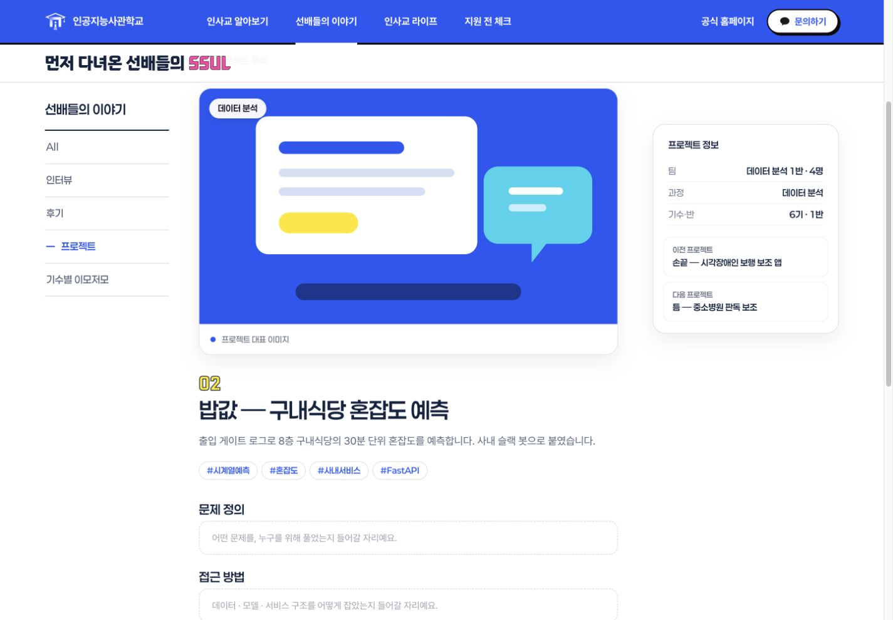
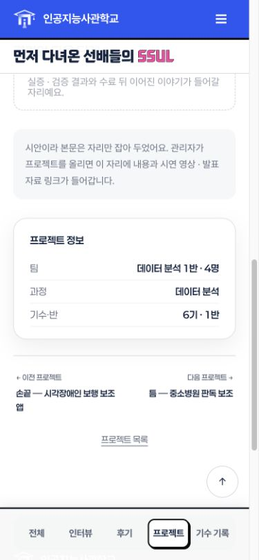
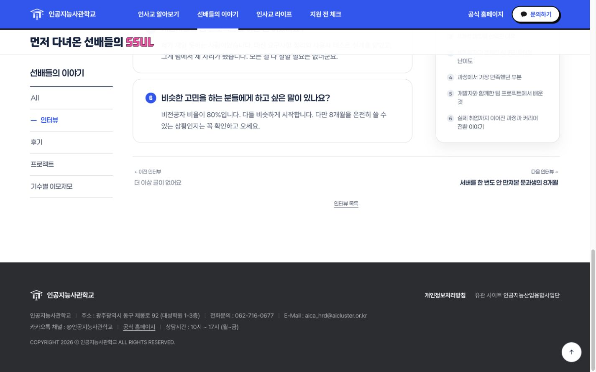
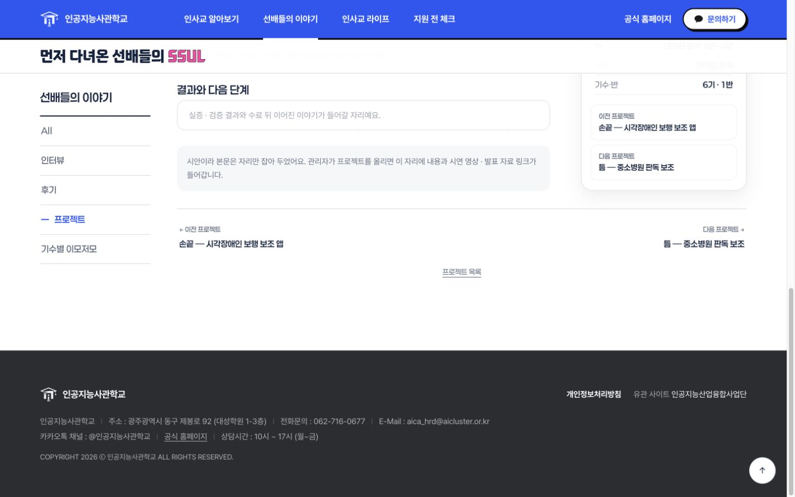

# 프로젝트 상세 정보·고정 카드 경계 수정

기준: PR #15 병합 후 `origin/main` d87b4ac. 브랜치: codex/story-detail-sidebar-fix.

## 변경

- 정적 프로젝트 상세 대표 이미지 배지를 기존 유형에서 과정명으로 변경하고, 정보 카드의 유형을 과정으로 변경했다. 목록 드롭다운·빈 결과·접근성 이름의 교과목 문구도 과정으로 통일했다.
- 기간 대신 기수·반을 표시한다. 기존 팀 정보의 반 번호를 사용했고, 반 정보가 없던 틈·파수는 사용자 요청으로 더미 1반을 넣었다. 데이터의 `cohortClass`는 정적 시안용이다. 제목·설명·태그도 기존 시안 데이터로 유지했다.
- PC 프로젝트 정보 카드에 이전·다음 링크를 복원했다. 현재 기수·과정 필터를 따르고 양끝에서는 더 이상 글이 없다는 안내를 표시한다.
- 모바일 600px 이하에서는 정보 카드 안의 이전·다음만 숨기며 하단 공통 탐색은 유지한다.
- 인터뷰·프로젝트 하단 공통 탐색을 본문/오른쪽 카드 그리드의 다음 형제로 이동했다. 오른쪽 sticky 카드의 컨테이너가 본문 끝에서 끝나므로 하단 탐색과 겹치지 않는다. 후기 모달 탐색 구조는 유지한다.
- 최신 main의 `19203cd` Spring 모바일 프로젝트 유형 필터와 테스트를 보존했다. 원격에 있던 전체 통합 브랜치를 다시 병합하지 않고 추가 수정 단일 커밋만 옮겼다.

## 검증

- npm run build, npm test **44개**, npm run check, git diff --check 통과.
- 격리 임시 폴더 `/private/tmp/aica-detail-sidebar-spring-20261020`로 export:spring 통과. 운영 서버/DB에는 내보내지 않았다.
- 실제 인앱 브라우저 PC 1440px에서 인터뷰 iv-1, 프로젝트 pj-2 끝까지 스크롤: 오른쪽 카드 하단이 본문 영역 하단과 같고 공통 탐색 상단은 그 아래에 위치함을 DOM 좌표로 확인했다.
- 모바일 360/390/430px에서 두 상세 화면의 가로 넘침 없음 및 탐색이 본문 그리드 밖에 배치됨을 확인했다.
- 프로젝트 정보 카드 내부 링크는 모바일 3종에서 숨김, PC에서 표시. 하단 공통 탐색은 모두 표시.
- 프로젝트 정보 카드의 다음 이동 pj-2→pj-3, 이전 이동 pj-3→pj-2 확인.
- 신규 자동 테스트는 탐색이 본문 그리드 밖의 형제로 배치되고 필터 재계산 후 중복 생성되지 않는지 확인한다.

## Spring 경계 및 미검증

신규 과정/기수·반 데이터는 기존 Spring API에 없으므로 내보내기에서 과정 배지와 항목은 기존 type/유형으로, 기수·반은 기존 duration/기간으로 되돌린다. 운영 DB에서 과정·반을 표시하려면 별도 API 지원 확인이 필요하다. 공통 상세 탐색 배치와 모바일 정보 카드 링크 숨김은 내보내기 자산에도 반영된다. 발행 정책/HTML escape/API 계약은 변경하지 않았다. 실제 Spring 서버·운영 DB·물리 기기·스크린리더·Windows 실행은 미검증이다.

## PC·모바일 비교

