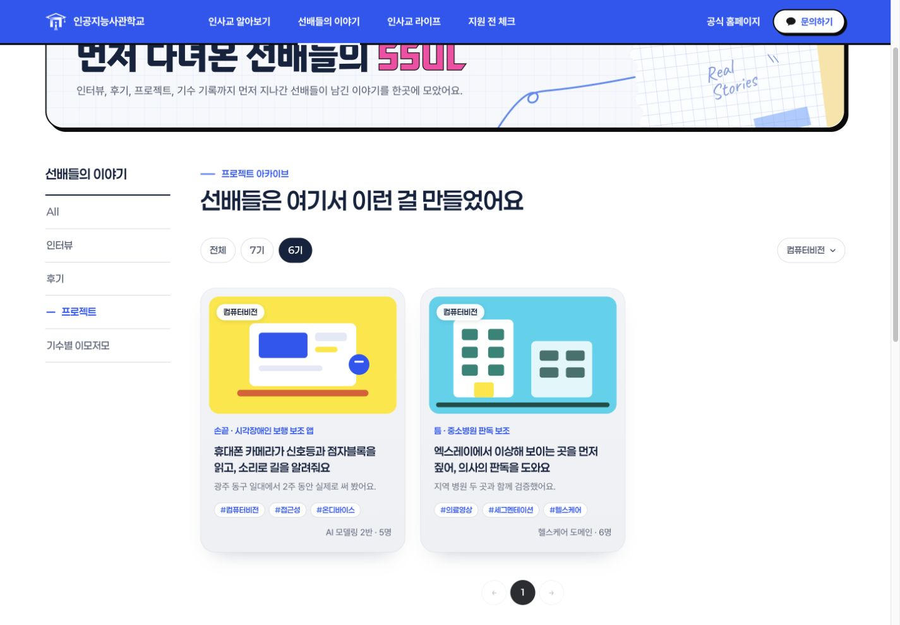
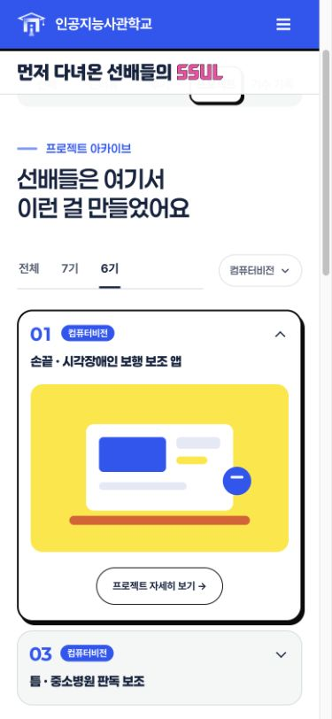
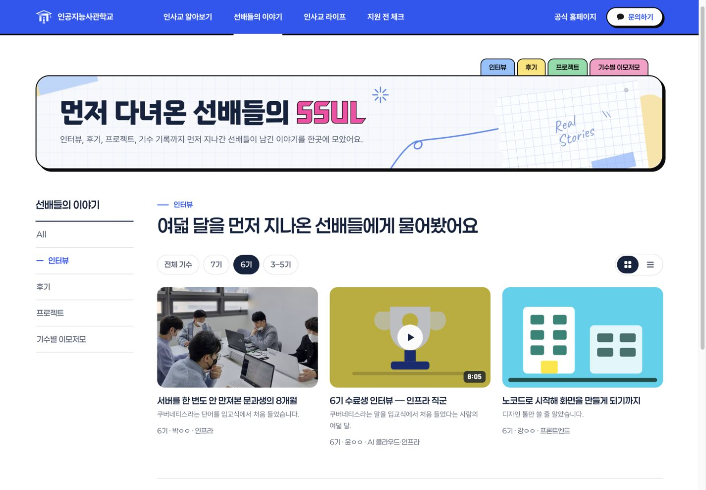
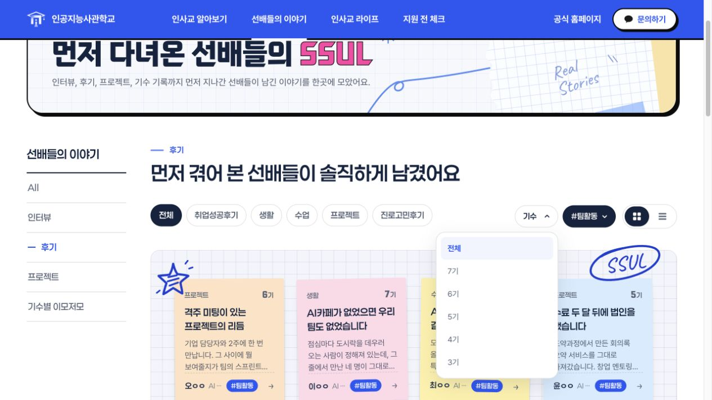
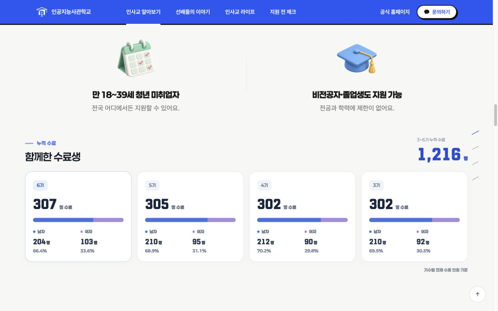
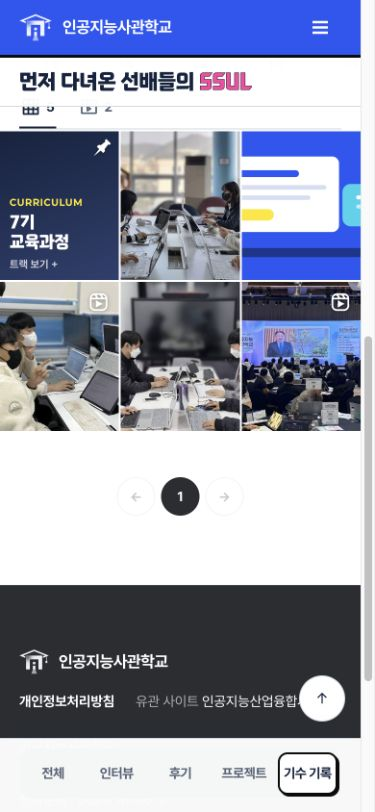

# 이야기 필터·페이지네이션 정리 검증

기준: PR #13·#14가 일반 merge commit으로 병합된 `origin/main` (`f2a7c0d`). 작업 브랜치: `codex/project-cohort-latest`. 기존 미추적 시안·문서·백업은 보존하고 포함하지 않았다.

## 최종 변경

- 어제 프로젝트 기수 필터(전체/7기/6기)와 7기 준비 중 패널, Windows 빌드 경로·줄바꿈 수정을 최신 main 위로 가져왔다.
- 정적 프로젝트 6개는 모두 6기이며, 교과목 7개 선택지를 추가했다. 배지는 유형 대신 교과목을 표시한다. 손끝/틈=컴퓨터비전, 밥값=데이터 분석, 돌아봄=AI클라우드 및 인프라, 말줄임=자연어처리, 파수=AI서비스 개발이다.
- 모바일은 기수 밑줄 탭과 교과목 드롭다운을 같은 줄에 둔다. 두 영역을 18px로 나누고 밑줄은 기수 영역에만 표시한다. PC는 기수 칩과 드롭다운을 사용한다. 모바일의 전체/기업연계/실증/창업 유형 탭은 사용자 요청으로 제거했다.
- 프로젝트는 6개씩 페이지를 나누며 단일 페이지에서도 이전/1/다음 버튼을 표시한다. 빈 결과/준비 중에서는 숨기고, 필터 변경 시 1페이지로 돌아온다. 상세 이전/다음은 페이지에 국한하지 않고 선택한 기수·교과목 전체를 따른다. 목록 복귀 상태를 유지한다.
- 후기 기수·태그 메뉴를 교과목 메뉴와 같은 둥근 패널·부드러운 그림자·선택 배경으로 맞췄다. 인터뷰 PC 칩은 공통 둥근 칩 스타일로 맞췄다.
- PC의 인터뷰/후기/프로젝트/기수별 이모저모 제목–첫 칩 간격을 실측 36px로 통일했다. 모바일 인터뷰 미리보기 카드 구성은 유지했다.
- 기수별 이모저모 페이지네이션 하단의 개수·범위 안내 문구만 제거했다.
- 알아보기 수료 카드를 6/5/4/3기 순서로 옮겼다. 수치·비율과 6기 강조를 유지했다.

## 확인 결과

- `npm run build`, `npm test` 41개, `npm run check`, `git diff --check` 통과.
- `npm run export:spring -- --output /private/tmp/aica-pr-spring-export-20261020` 통과. 기존 백오피스나 운영 DB에는 내보내지 않았다.
- 실제 인앱 브라우저에서 360/390/430px 및 1440px 프로젝트 필터·배지·페이지네이션·7기 패널·6기 보기·빈 결과·긴 선택명을 확인했다. 가로 넘침 없음.
- 교과목 선택 후 Escape 닫기와 summary 포커스 복귀 확인. 프로젝트 상세 탐색의 교과목 교집합과 모바일/PC 전환 확인.
- 원본 데이터를 바꾸지 않은 `/private/tmp`의 임시 7개 카드 화면에서 PC/모바일 2페이지에 1개 표시, 마지막 다음 비활성, 필터 변경 시 1페이지 복귀를 확인했다. 임시 데이터는 커밋하지 않았다.
- 후기 기수/태그 선택 동작, 인터뷰 칩 선택, 네 PC 목록의 제목–칩 36px, 수료 카드의 모바일 순서, 기수별 페이지네이션 문구 제거를 확인했다.
- 물리 기기·스크린리더·실제 Windows 실행은 미검증이다.

## Spring 경계

신규 프로젝트 기수/교과목 메타데이터, 필터 UI·준비 중/빈 결과 안내·정적 페이지네이션 초기화는 기존 Spring API 계약에 포함하지 않는다. 내보내기에서 이 UI와 메타데이터를 제외하고 카드 배지는 기존 `type` 필드로 되돌린다. 따라서 운영 DB 프로젝트의 교과목 분류/배지/페이지네이션은 이 PR만으로 적용되지 않는다. 별도 백엔드 지원 확인이 필요하다. 공통 드롭다운/간격 CSS 및 모바일 유형 탭 제거는 내보내는 프론트 자산에도 영향을 준다. Spring 내보내기 회귀 테스트는 통과했지만 실제 Spring 서버·운영 DB 화면은 이번 작업에서 실행하지 않았다. 기존 공개본 정책, escape 및 API 계약은 유지한다.

## 캡처

PC와 모바일의 최종 프로젝트 필터 비교:

[모바일 360](projects-360.png) · [모바일 430](projects-430.png)

