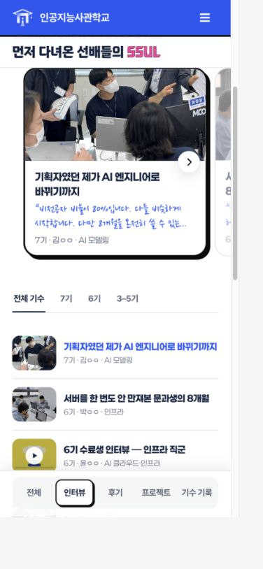
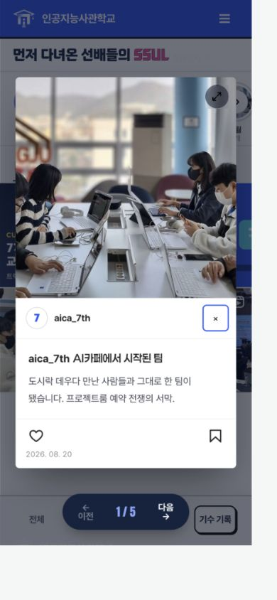
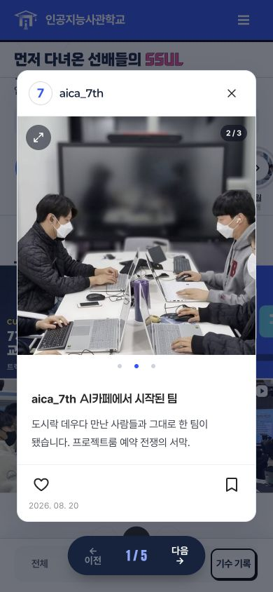
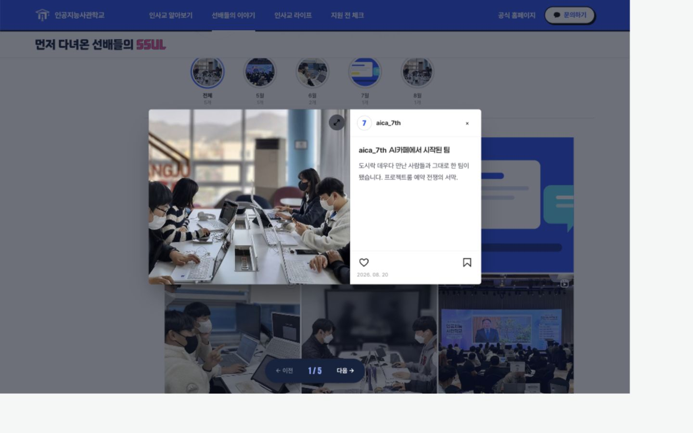
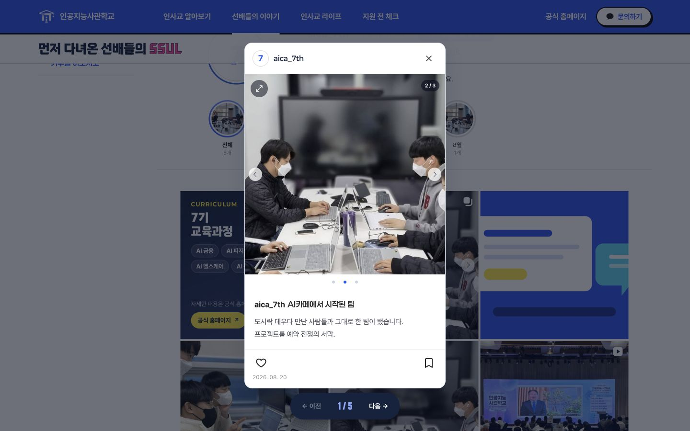

# 인터뷰 순환 카드·기수 기록 사진 갤러리 검증

기준: 2026-10-20 `origin/main`의 `5ff4a0155eee61d36b5e3982a02b1799a93ac721`.
작업 브랜치: `codex/mobile-interview-loop`.

원격을 다시 가져온 뒤 HEAD와 origin/main의 선행·후행 커밋이 모두 0개임을 확인했습니다. 기존 PR #13·#14·#15·#16·#17은 GitHub에서 모두 병합 완료 상태이며, 그 변경은 최신 main에 이미 포함되어 있습니다. 이번 PR은 이후의 인터뷰·기수 기록 수정만 포함합니다.

## 변경

- 모바일 추천 인터뷰의 첫 카드를 중앙에 고정하고 양쪽에 이웃 카드가 보이도록 했습니다. 양방향 순환, 연결 시 투명도 깜빡임 방지, 키보드 이동·포커스 복귀를 포함합니다. 화살표는 사진 아래 경계에 걸치고 제목과 여백을 확보했습니다.
- 기수 기록은 대표 이미지와 추가 `photos`를 하나의 갤러리로 보여줍니다. 중복 주소를 제외하고 최대 10장입니다. 정적 콘텐츠가 10장을 넘으면 빌드가 실패하며, 공개 화면도 최대 10장만 노출합니다.
- 피드·상세·확대 보기에서 모바일 스와이프, PC 드래그, 키보드로 사진을 넘깁니다. PC의 작은 반투명 좌우 화살표는 양쪽이 항상 활성화되며 첫·마지막 사진을 순환합니다. 모바일에서는 화살표를 숨깁니다.
- 점은 최대 5개로 제한하고 현재 위치에 따라 범위를 이동합니다. 더 있는 쪽의 끝 점은 작게 표시합니다. 상세창의 점은 사진 아래 흰 영역에 놓았으며 직접 눌러 선택할 수 있습니다.
- PC·모바일 상세창을 같은 세로 카드로 정리했습니다. 상단 프로필바, 16px 모서리, 흰색 확대 아이콘, 선명한 닫기 X, 하트·북마크·날짜를 포함합니다. 낮은 PC 창에서는 카드 내부를 스크롤할 수 있습니다.
- 영상 썸네일 아이콘과 모바일 전체·영상 보기 아이콘을 정리했습니다.
- 첫 정적 게시물의 3장 예시는 기존 사이트 사진을 재사용한 디자인 확인용 구성입니다. 새로운 사실·후기·기관 정보는 추가하지 않았습니다.

## 실행 및 화면 확인

- `npm run build`: 11개 생성 성공
- `npm test`: 57개 통과
- `npm run check`: 11개 생성 결과 일치
- `git diff --check`: 통과
- 기존 4173 미리보기 서버 재사용. 변경 전 화면은 최신 main의 추적 파일만 임시 폴더에 추출하여 별도 서버에서 확인했습니다.
- CSS 너비 360·390·430px, PC 1440×900 및 1280×768·600에서 확인했습니다. 카드·점 표시의 가로 넘침 없이 접근할 수 있습니다.
- 사진 점 선택·마우스 드래그·PC 양방향 순환, 피드 드래그 시 상세창 열림 방지, 확대·Escape·닫기, 하트·저장, 영상 상세 재생 버튼을 확인했습니다.
- 10장 임시 예시에서 최대 5개 점이 첫·중간·마지막 사진에 맞춰 이동하는 것을 확인했습니다. 이 10장 예시는 실제 콘텐츠 데이터에 저장하지 않았습니다.
- 테스트는 사진 동기화·10장 제한·5개 점의 이동·수직 스크롤과 재사용 상세창의 포인터 처리·화살표 순환·기존 포커스 트랩·Spring 공개 슬롯을 확인합니다.

## 전후 화면

390px 모바일 및 1440px PC 기준입니다.

| 화면 | 최신 main | 수정 후 |
| --- | --- | --- |
| 모바일 추천 인터뷰 |  |  |
| 모바일 게시물 상세 |  |  |
| PC 게시물 상세 |  |  |

## Spring 영향과 확인 범위

기존 공개 `s.photos` 데이터를 갤러리에 연결하며 API 필드·DB 발행 정책·관리자 권한은 변경하지 않습니다. Spring 내보내기는 정적 예시 사진 슬롯을 제거하고 기존 escaped `s.photos` 반복문 하나만 유지합니다. 정적 3장 예시는 Spring 최초 가져오기 데이터에 자동 추가하지 않습니다.

10장 제한은 이 저장소의 정적 데이터 검사와 공개 화면에 적용했습니다. 실제 파일 업로드·저장 제한은 별도 백오피스에서 적용해야 합니다. Spring 서버 실행과 실제 휴대폰의 터치, 스크린리더 검증은 수행하지 않았습니다. 포인터 동작과 포커스 처리는 로컬 브라우저 및 자동 테스트 범위에서 확인했습니다.

다른 작업자의 미추적 파일과 비교용 시안 폴더는 포함하지 않습니다. main 직접 푸시·병합·공개 배포는 하지 않습니다.
